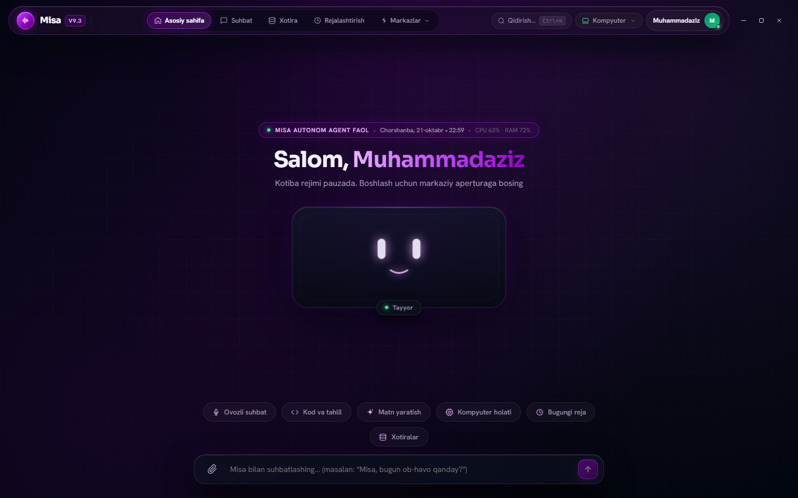
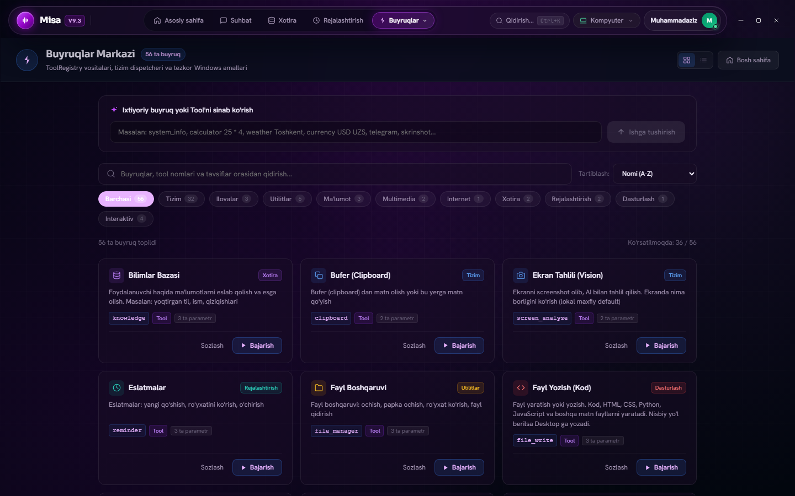
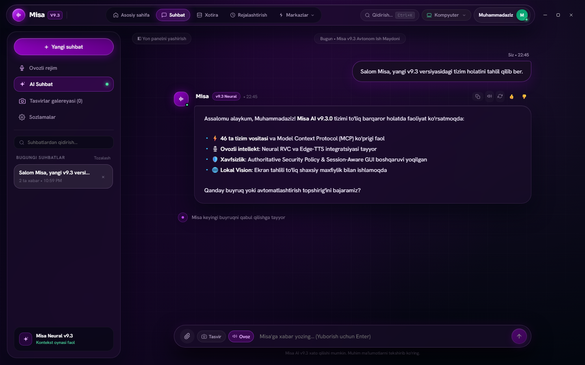
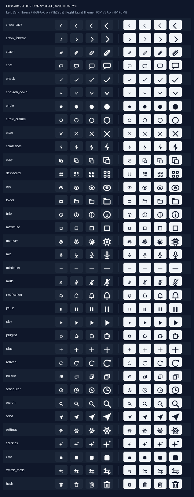

# 🔷 MISA AI (sobiq Mikasa AI) — Autonomous Desktop Assistant & Intelligence Hub

> **📢 MUHIM E'LON (v9.0.0 Rebranding): 9-versiyadan boshlab "Mikasa AI" loyihasi rasmiy ravishda "Misa" (`Misa AI`) deb yuritiladi!**  
> *1.0.0 dan 8.0.0 gacha bo'lgan barcha barqaror versiyalarda loyiha **Mikasa AI** nomi bilan ishlab chiqilgan va arxivlangan (`main` / `dev-v8.0.0`). **9.0.0 versiyadan (`dev-v9.0.0`) boshlab** loyiha yadrosi, desktop interfeysi (`Misa/`), ovozli chaqiruv tizimi ("Salom Misa"), Windows PC agenti va barcha hujjatlar **Misa AI** nomi ostida davom ettiriladi.*

> **O'zbek tilidagi birinchi professional avtonom AI desktop yordamchisi va aqlli orkestratori**  
> React 19 + Tauri 2.0 zamonaviy interfeysi, Supabase Auth ko'p foydalanuvchili (multi-tenant) xavfsiz autentifikatsiyasi, Google OAuth 2.0, Ed25519 kriptografik PC Agent Enrollment & Pairing, Universal Telegram Bot (`@Mikasa_ai_agent_bot`) orqali masofaviy boshqaruv, Wake-on-LAN, ko'p bosqichli intellektual boshqaruv (Agent Loop 2.0), Authoritative Tool Security, Session-Aware Windows GUI Controller va Ed25519 imzolangan xavfsiz auto-update tizimi.

[](https://www.python.org/)
[](Misa/)
[](https://microsoft.com/windows)
[](https://github.com/Muxammadaziz-boss/Misa/releases/tag/v9.0.2)
[](https://github.com/Muxammadaziz-boss/Misa/tree/dev-v9.0.0)
[](tests/)
[](LICENSE)

---

## 🏷️ Loyiha Nomi Evolyutsiyasi: Mikasa AI ➔ Misa AI (v9.0.0+)

| Versiya davri | Rasmiy nom | Git Branch | Frontend Katalogi | Izoh |
| :--- | :--- | :--- | :--- | :--- |
| **v1.0.0 – v8.0.0** | **Mikasa AI** | `main`, `dev-v8.0.0` | `mikasa-7/` | 8-versiyagacha bo'lgan barcha relizlar va tarixiy arxitektura o'z holicha saqlanadi. |
| **v9.0.0 – v9.0.1** | **Misa AI** | `dev-v9.0.0` | `Misa/` | Yangi Tauri 2.0 + React 19 interfeysi, ovozli boshqaruv ("Salom Misa") va PC Agent. |
| **v9.0.2 (Hozirgi)** | **Misa AI** | `dev-v9.0.0` | `Misa/` | **Rasmiy Barqaror Reliz (Latest)**: Authoritative Security, Windows GUI Controller, 100% test qamrovi. |

---

## 📸 Ilovaning Haqiqiy Interfeysi (Visual Showcase)

### 🪐 1. Bosh Sahifa va Interaktiv Misa Orb
*Haqiqiy vaqt rejimida yordamchi holatini (10 xil jonli holat: idle, listening, thinking, speaking, executing va h.k.) ko'rsatuvchi vizual yadro, jonli telemetriya, tezkor AI harakatlari va ovozli boshqaruv.*


---

### ⚡ 2. Buyruqlar Markazi — 29+ Tizim Vositalari (Tool System 2.0)
*Klaviatura orqali tezkor boshqaruv (`Ctrl+K`), tizim asboblarini toifalash, interaktiv parametrlar va xavfsiz ijro.*


---

### 💬 3. Intellektual AI Suhbat va Zamonaviy Glassmorphism
*Fikrlovchi Gemini va OpenRouter modellari, ko'p qatorli yozish maydoni, kontekstni to'liq saqlash, rasm generatsiyasi va silliq aero-shisha vizual effektlari.*


---

### 🎨 4. Quiet Intelligence — Maxsus Vektor Ikonkalar Tizimi
*Matnli emojilardan butunlay xoli, 26 ta kanonik SVG piktogrammalar va premium qora dizayn karkasi.*


---

## 🌟 9-Versiyadagi Asosiy Imkoniyatlar (v9.0.0 – v9.0.2 Latest)

1. **🎙️ Ovozli Intellekt va Wake-Word Dvigateli ("Salom Misa")**:
   - Haqiqiy vaqt rejimida Voice Activity Detection (VAD) va fon shovqinlarini filtrlash.
   - Mikrofon monitoringi va PortAudio barqarorligi (xotira buzilishlari va halqalanishlar to'liq bartaraf etilgan).
   - Ovozli javob qaytarish va Misa Orb jonli reaksiyalari.

2. **🔐 Vakolatli Asboblar Xavfsizlik Siyosati (Authoritative Security Policy)**:
   - Barcha destruktiv va yuqori xavfli asboblar (`system_shutdown`, `system_restart`, `delete_file`, `keyboard_type`, `mouse_click`) uchun markaziy xavfsizlik dvigateli.
   - Kriptografik bir martalik `_confirmation_token`: parametrlar SHA-256 xeshi bilan qat'iy bog'langan, 60s yashash muddatli (TTL) va takroriy ishlatishdan himoyalangan (`TOKEN_ALREADY_USED`, `PARAMS_MISMATCH`).
   - Lokal API izolyatsiyasi: `127.0.0.1:18420/api/plugins/execute` endpointi begona Origin/Referer yoki tasdiqlanmagan sessiyalarni 403 `UNAUTHORIZED_LOCAL_CALLER` bilan bloklaydi.

3. **🪟 Sessiyadan Xabardor Windows GUI Controller**:
   - `core/gui/controller.py` orqali DPI-aware oyna boshqaruvi va sarlavha/sinf bo'yicha oynalarni aniqlash (`find_window`).
   - Win32 `AttachThreadInput` va `BringWindowToTop` orqali Windowsning "focus stealing prevention" cheklovini yengib, oynani ishonchli faollashtirish.
   - Qat'iy precondition (nishon oyna fokusdaligi) va postcondition (matn kiritilgach oyna mavjudligi) tekshiruvlari.
   - Har qanday favqulodda vaziyatda harakatlarni bir zumda to'xtatuvchi `abort()` nazorati.

4. **🤖 Remote Agent Lifecycle & Poller/Executor**:
   - `agent/executor.py` dagi `RemoteCommandExecutor` va `CommandPoller` bevosita `agent/lifecycle.py` boshqaruviga to'liq ulandi.
   - Idempotent polling, takroriy startlardan himoya va 32-bayt nonce yordamida replay-hujumlardan to'liq himoyalangan xizmat.
   - Shutdown/restart va uzilishlarda barcha fon jarayonlari va soketlarni xavfsiz tozalash mexanizmi.

5. **🧠 Agent Loop Verifikatsiyasi & Lokal Vision Maxfiyligi**:
   - Agent rejasini bajarish jarayonida cheksiz sikllardan (infinite loop) himoya.
   - Rejalarga bevosita GUI amallari (click, type, screenshot) integratsiya qilingan.
   - Foydalanuvchi ekrani tasvirlari hech qanday tashqi AI bulutlariga yuborilmaydi (to'liq lokal tahlil qilinadi).

6. **⚙️ Desktop Supervisor Handshake & Platform Hardening**:
   - Rust Tauri supervisor va Python backend o'rtasida `GET /api/health` orqali qat'iy versiya mosligi (`version: 9.0.2`, `app: Misa AI`).
   - Telemetriya va loglarda foydalanuvchi parollari va API kalitlari avtomatik `[REDACTED]` holatiga keltiriladi.

---

## 🏛️ 8-Versiyadagi Barcha Yangiliklar va To'liq Arxitektura (v8.0.0 / Phases 35–48)

* **🌐 Masofaviy Boshqaruv & Wake-on-LAN**: UDP Magic Packet orqali kompyuterni masofadan uyg'otish va kriptografik `RemoteCommandEnvelope` (120s TTL).
* **🔐 Masofaviy Sessiya Autentifikatsiyasi**: 3 darajali ruxsat profillari (`SAFE_READONLY`, `STANDARD_CONTROL`, `FULL_ADMIN`) va 15+ masofaviy vositalar.
* **🤖 Universal Telegram Bot (`@Mikasa_ai_agent_bot`)**: 6-xonali OTP kod orqali Telegram akkauntni xavfsiz bog'lash va brute-force himoyasi.
* **🖥️ Ko'p Qurilmali Boshqaruv (Multi-Device)**: Bitta hisobga bir nechta kompyuterni ulash va alohida izolyatsiyalangan sessiyalar yuritish.
* **🛡️ Supabase Auth, JWT & Multi-Tenant RLS**: Zero backend password storage, ES256/RS256 JWKS va HS256 tekshiruvi, ma'lumotlar bazasi darajasida RLS izolyatsiyasi.
* **🔑 Kriptografik PC Agent Enrollment & Ed25519 Pairing**: Asimmetrik Ed25519 kalitlar juftligi, Windows DPAPI shifrlash va 32-bayt nonce challenge-response.
* **🔗 Google OAuth 2.0**: Desktop Tauri ilovasi va mahalliy listener o'rtasida mustahkam OAuth ko'prigi.
* **⚙️ Mustaqil PC Agent & Sandboxed Tool Execution**: `PathSecurityValidator` orqali tizim kataloglari va maxfiy ma'lumotlarni (`C:\Windows`, `.ssh`, `.env`) qat'iy bloklash.
* **🔄 Secure Auto-Update & Crash-Safe Rollback Engine**: Ed25519 raqamli imzosi va SHA-256 bilan himoyalangan yangilanishlar.

---

## 📦 Rasmiy Windows Relizlar (v9.0.2 — Rasmiy Barqaror Reliz / Latest)

Barcha reliz fayllari mustaqil kriptografik SHA-256 xeshlari bilan tekshirilgan va rasmiy [GitHub Releases Sahifasida](https://github.com/Muxammadaziz-boss/Misa/releases/tag/v9.0.2) joylashtirilgan:

| Fayl nomi | Tavsif | Hajmi | SHA-256 Checksum | Yuklab olish |
| :--- | :--- | :---: | :--- | :---: |
| **`Misa-AI-Setup-v9.0.2.exe`** | ⭐ **Windows NSIS O'rnatuvchisi (Tavsiya etiladi)** | **13.55 MB** | `30cca0a57f4140dd2e2effbea83751a6299ac9f03179e516ecb2d8facc031319` | [Yuklab olish](https://github.com/Muxammadaziz-boss/Misa/releases/download/v9.0.2/Misa-AI-Setup-v9.0.2.exe) |
| **`Misa-AI-v9.0.2-Portable.zip`** | 📦 **To'liq Portativ Paket (Backend + DLL bilan)** | **236.55 MB** | `fb8eb81cf2ad3f039621d8d872a6bb7307f4bd2fb074d2e71466e7e4b4a9b218` | [Yuklab olish](https://github.com/Muxammadaziz-boss/Misa/releases/download/v9.0.2/Misa-AI-v9.0.2-Portable.zip) |
| **`Misa-AI-v9.0.2.exe`** | 🚀 **Mustaqil Desktop Ilova (Self-Contained Executable)** | **5.20 MB** | `fb8a74752175a9d401cced1d5af3783ef20d2397c74f7e9042de476e5a809a5c` | [Yuklab olish](https://github.com/Muxammadaziz-boss/Misa/releases/download/v9.0.2/Misa-AI-v9.0.2.exe) |
| **`Misa-AI-v9.0.2.msi`** | 🏢 **Standart Windows MSI O'rnatuvchisi** | **14.37 MB** | `d07688b384327c978320335eba9eae539d5da5e99f3bb1aefd4ec77bdb0576d8` | [Yuklab olish](https://github.com/Muxammadaziz-boss/Misa/releases/download/v9.0.2/Misa-AI-v9.0.2.msi) |
| **`SHA256SUMS.txt`** | 🔐 **Kriptografik Nazorat Summalari** | **358 B** | Mustaqil tekshirilgan | [Yuklab olish](https://github.com/Muxammadaziz-boss/Misa/releases/download/v9.0.2/SHA256SUMS.txt) |
| **`version_manifest.json`** | ⚙️ **Avto-Yangilanish Rasmiy Manifesti** | **2.56 KB** | Ed25519 imzolangan | [Yuklab olish](https://github.com/Muxammadaziz-boss/Misa/releases/download/v9.0.2/version_manifest.json) |

### 🏛️ Tarixiy Relizlar Arxivi
- [Misa AI v9.0.1 Release](https://github.com/Muxammadaziz-boss/Misa/releases/tag/v9.0.1) — Audio loop & anti-leak hardening
- [Misa AI v9.0.0 Release](https://github.com/Muxammadaziz-boss/Misa/releases/tag/v9.0.0) — Misa AI Rebranding & Tauri 2.0 UI
- [Mikasa AI v8.0.0 Release](https://github.com/Muxammadaziz-boss/Misa/releases/tag/v8.0.0) — Sobiq Mikasa AI arxivi

---

## 🚀 O'rnatish va Ishga Tushirish

### 1-usul: Tayyor Desktop Ilovani Ishlatish (Foydalanuvchilar uchun)
1. **O'rnatuvchi orqali (Eng oson va tavsiya etilgan)**:  
   [Misa-AI-Setup-v9.0.2.exe](https://github.com/Muxammadaziz-boss/Misa/releases/download/v9.0.2/Misa-AI-Setup-v9.0.2.exe) ni yuklab oling va ishga tushiring. O'rnatuvchi barcha kerakli kutubxonalarni avtomatik sozlaydi va ish stoli yorlig'ini yaratadi.
2. **Portativ rejimda (O'rnatmasdan)**:  
   [Misa-AI-v9.0.2-Portable.zip](https://github.com/Muxammadaziz-boss/Misa/releases/download/v9.0.2/Misa-AI-v9.0.2-Portable.zip) yoki mustaqil [Misa-AI-v9.0.2.exe](https://github.com/Muxammadaziz-boss/Misa/releases/download/v9.0.2/Misa-AI-v9.0.2.exe) ni yuklab olib, to'g'ridan-to'g'ri ishga tushiring.

### 2-usul: Dasturchilar uchun (Manba kodi orqali)
```bash
# 1. Repozitoriyani klonlash va dev-v9.0.0 branchiga o'tish
git clone https://github.com/Muxammadaziz-boss/Misa.git
cd Misa
git checkout dev-v9.0.0

# 2. Python 3.11+ virtual muhiti
python -m venv .venv
.venv\Scripts\activate
pip install -r requirements.txt

# 3. Frontend (Misa)
cd Misa
npm install
npm run build
cd ..

# 4. Tizimni ishga tushirish
python main.py
```

---

## 📁 Loyiha Kataloglar Tuzilmasi (v9.0.2 — Misa AI)

```
Misa/ (yordamchi_9.0.0)
├── agent/                      # Windows PC Agent, Lifecycle & Secure Tools Execution
│   ├── auth.py                 # Agent autentifikatsiyasi & Ed25519 Challenge-Response
│   ├── config.py               # Agent konfiguratsiyasi & DPAPI kalit saqlash
│   ├── executor.py             # Masofaviy buyruqlar ijrochisi va CommandPoller
│   ├── heartbeat.py            # FSM holat mashinasi va jonli signallar
│   ├── lifecycle.py            # Agent hayot sikli boshqaruvi
│   ├── tools.py                # 15 ta tizim asboblari & PathSecurityValidator
│   └── transport.py            # Kriptografik imzolangan HTTP transport
├── core/                       # Intellektual yadro va backend xizmatlari
│   ├── v8/                     # Supabase Auth, UpdateService, Telegram Gateway, OAuth
│   ├── intelligence/           # Agent Loop 2.0, Planner DAG, Verifier, PermissionEngine
│   ├── tools/                  # Tool System 2.0 (29+ lokal va tizim asboblari, Confirmation Tokens)
│   ├── gui/                    # Session-Aware Windows GUI Controller (controller.py)
│   ├── api_server.py           # Asinxron REST & WebSocket server (18420-port)
│   └── audio_service.py        # VAD, ovozli monitor va audio oqimlar boshqaruvi
├── docs/                       # Loyiha arxitekturasi, qo'llanmalar va rasmlar
│   └── assets/                 # README uchun yuqori sifatli UI skrinshotlar
├── Misa/                       # Tauri 2.0 + React 19 Desktop UI
│   ├── src/                    # Zamonaviy React komponentlari (Orb, Dashboard, Chat, Auth)
│   ├── src-tauri/              # Rust Tauri 2.0 desktop qobig'i va Backend Supervisor
│   └── dist/                   # Ishlab chiqarish uchun yig'ilgan statik fayllar
├── packaging/                  # PyInstaller backend/agent bundler va Ed25519 reliz imzolash
├── release/                    # Yig'ilgan desktop ilovalar arxivi (v9.0.2 Latest)
├── supabase/                   # Supabase PostgreSQL migratsiyalari va RLS siyosatlari
├── tests/                      # 345+ dan ortiq avtomatlashtirilgan backend va xavfsizlik testlari
├── main.py                     # Asosiy Misa AI tizim boshqaruvchisi
├── requirements.txt            # Python bog'liqliklari
├── SETUP.md                    # To'liq sozlash qo'llanmasi
├── RELEASE_NOTES.md            # Rasmiy reliz qaydlari
└── README.md                   # Loyiha bosh sahifasi
```

---

## 🧪 Sifat Kafolati va Sinov Ko'rsatkichlari (100% PASS)

Loyiha to'liq integratsion, kriptografik, multi-tenant RLS va Windows sandbox testlari bilan qamrab olingan:
```bash
# 1. Backend testlari (345 ta test)
python -m unittest discover tests/ "test_*.py"

# 2. Frontend testlari (33 ta test)
cd Misa && npm test

# 3. Real Windows Smoke testlari (8 ta test)
python tests/smoke_test_rc.py
```
* **Python Backend**: `345 / 345 PASS` (100% barqaror)
* **Frontend (React 19)**: `33 / 33 PASS` (100% barqaror, build 2.07s)
* **Desktop Qobig'i (Rust)**: `cargo check --lib` (0 xatolik)
* **Real Windows Smoke**: `8 / 8 PASS` (Notepad sandbox, GUI blocks, token security)
* **Kriptografiya**: Ed25519, ES256/RS256 JWKS, SHA-256, Windows DPAPI, Constant-time verification

---

## 📄 Litsenziya va Muallif

* **Muallif:** Muxammadaziz ([@Muxammadaziz-boss](https://github.com/Muxammadaziz-boss))
* **Repozitoriya:** [https://github.com/Muxammadaziz-boss/Misa](https://github.com/Muxammadaziz-boss/Misa)
* **Litsenziya:** MIT License
