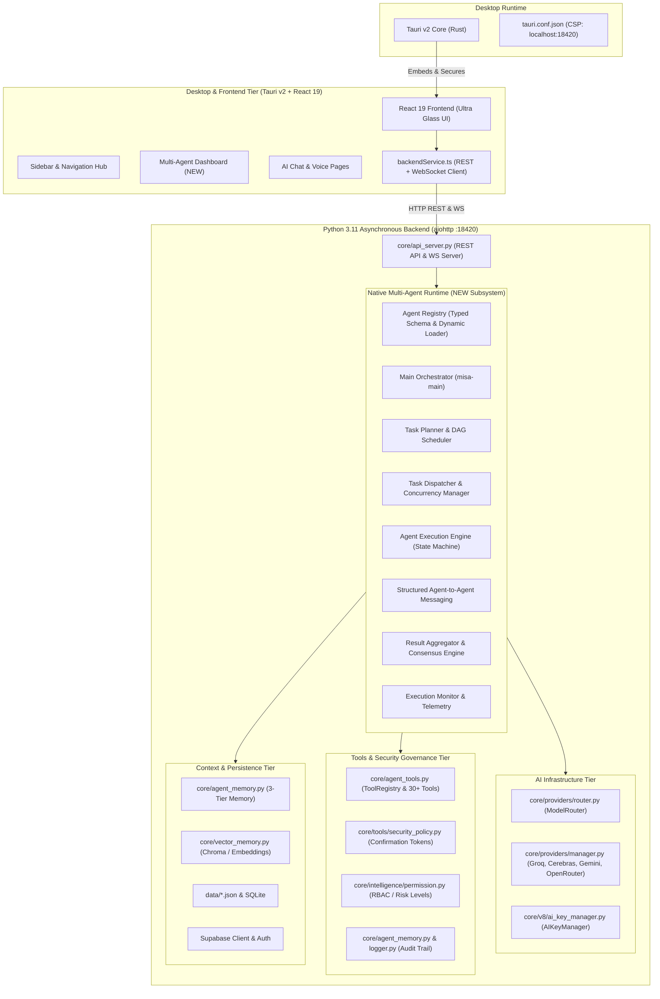

# MISA AI 9.0.0 — NATIVE MULTI-AGENT ARCHITECTURE DISCOVERY & AUDIT REPORT

**Date:** November 4, 2026  
**Document Version:** 1.0.0  
**Target System:** MISA AI Platform v9.3.0 (`yordamchi_9.0.0`)  
**Scope:** Architecture discovery, baseline capability verification, subsystem mapping, integration opportunities, and risk evaluation for the Native Multi-Agent Runtime.

---

## 1. Executive Summary & Objective

The primary objective is to implement a production-grade, enterprise-scale **Native Multi-Agent System (MAS)** directly inside the MISA application platform (`yordamchi_9.0.0`).

Unlike an IDE extension or prompt template pack, this implementation introduces a native, self-contained multi-agent runtime operating entirely within MISA's backend and frontend architecture. It enables autonomous specialist agents to collaborate, plan, delegate, execute verified actions with strict security guardrails, communicate over structured internal protocols, and present observable real-time telemetry to the user.

This document records the architectural audit of MISA v9.3.0, mapping its frontend, backend, desktop shell, AI providers, memory system, tool calling, security models, and lifecycle hooks to ensure 100% backward compatibility and seamless integration.

---

## 2. System Architecture Overview



---

## 3. Subsystem Audit & Baseline Analysis

### 3.1. Frontend Architecture
- **Framework & Libraries:** React 19.1.0, TypeScript 6.0.3, Vite 8.0.16.
- **Design System:** MISA Ultra Glass Aesthetic (`Misa/src/styles/tokens.css`, `globals.css`):
  - Canvas: Deep Midnight `#02060E`.
  - Accent: Luminous Violet `#9303C5` and `#C04CFD`.
  - Surfaces: Multi-layer blur (`backdrop-filter: blur(24px)`), translucent glass panels (`rgba(24, 13, 36, 0.55)`), specular borders (`rgba(232, 179, 255, 0.22)`).
  - Typography: Sora, Inter, JetBrains Mono.
- **Navigation Structure:** `AppShell.tsx` and `Sidebar.tsx` organize sections into:
  - `ASOSIY`: Home (`/`), AI Suhbat (`/chat`)
  - `INTELLIGENCE`: Buyruqlar (`/commands`), Xotira (`/memory`)
  - `SYSTEM`: Rejalashtiruvchi (`/scheduler`), Plaginlar (`/plugins`), Qurilmalar (`/devices`), Masofaviy Boshqaruv (`/remote`), Telegram Bot (`/telegram`), Profil (`/account`).
- **Communication Layer:** `Misa/src/services/backendService.ts` maintains a robust singleton connector handling:
  - Base URL: `http://127.0.0.1:18420`.
  - WebSocket: `ws://127.0.0.1:18420/api/ws` with auto-reconnect, heartbeat, and status event broadcasts.
  - Token scrubbing, OAuth redirect sanitization, and structured error unwrapping.

### 3.2. Desktop Shell & Tauri Integration
- **Engine:** Tauri v2 (`ai.misa.desktop`, v9.3.0).
- **Configuration:** `tauri.conf.json` with strict Content Security Policy (CSP):
  - `default-src 'self' tauri: http://localhost:18420 ws://localhost:18420 http://127.0.0.1:18420 ws://127.0.0.1:18420;`
  - Connects to Supabase, Google APIs, and Railway cloud fallback.
- **Packaging:** NSIS currentUser installer for Windows, embedded WebView2 bootstrapper.

### 3.3. Backend Architecture
- **Runtime:** Python 3.11.9 asynchronous web server (`aiohttp.web`) hosted on `127.0.0.1:18420`.
- **Server Entrypoint:** `core/api_server.py` and `core/production_server.py`.
- **Module Structure:**
  - `core/providers/`: Provider abstraction and model routing.
  - `core/intelligence/`: Intent classification, memory types, permissions, text cleaning.
  - `core/tools/`: Tool contracts, runner, security policy, and capabilities registry.
  - `core/agents/`: Existing basic single-agent prototypes (`BaseAgent`, `ManagerAgent`, `CoderAgent`, `ResearchAgent`, `SystemAgent`).

### 3.4. Existing AI Provider Abstraction & Model Routing
- **Architecture:** `core/providers/manager.py` implements `ProviderSystem` coordinating:
  1. **Groq:** Ultra-fast primary provider (`qwen/qwen3.8-27b`).
  2. **Cerebras:** Wafer-scale inference fallback (`qwen-3.8-27b`).
  3. **Google Gemini:** High-context multimodal provider (`gemini-flash-lite-latest`, `gemini-1.5-pro`).
  4. **OpenRouter:** Free model aggregator and fallback tier.
  5. **NVIDIA NIM:** Specialized open model hosting.
- **ModelRouter (`core/providers/router.py`):**
  - Task classification: Vision, Tool Calling, Code, Long Context, Complex Reasoning, Fast Chat.
  - Scoring engine evaluating model capabilities, speed, context window, and provider health.
  - Deterministic fallback chain with cooldown and exponential backoff retry.
- **Standardized Contracts:** `AIRequest` and `AIResponse` in `core/intelligence/types.py`.

### 3.5. Existing Memory & Context Architecture
- **3-Tier Structure in `core/agent_memory.py`:**
  1. *Short-Term (RAM):* Sliding window deque (default 20 interactions).
  2. *Mid-Term (Persistent JSON):* Conversation history (`data/agent_conversations.json`).
  3. *Long-Term (Persistent JSON):* User profile (`data/agent_profile.json`) and semantic facts (`data/agent_knowledge.json`).
- **Vector Memory:** `core/vector_memory.py` for semantic retrieval and context augmentation.

### 3.6. Tool & Function Calling System
- **Tool Contract:** `ToolContract2` (`core/tools/contract.py`) enforcing schema validation, risk levels (`LOW`, `MEDIUM`, `HIGH`), timeouts, capabilities, and execution policies.
- **Built-in Tools (`core/agent_tools.py`):** 30+ registered tools including:
  - System commands, process manager, screen capture, keyboard/mouse automation.
  - Web search, calculator, translator, currency converter, weather, reminders.
  - Local file viewer, file writer, secret vault, sandbox runner, vector search.
- **Security & Human-in-the-Loop:** `core/tools/security_policy.py` generates cryptographic one-time confirmation tokens (`ConfirmationTokenManager`) with TTL and SHA-256 parameter hashing for high-risk actions.

### 3.7. Authentication & Security Policy
- **Local & Cloud Auth:** Supabase Auth (`supabaseClient.ts`, `core/v8/auth_manager.py`) with local session caching and token scrubbing.
- **Safe Protocol:** OWASP LLM06 / LLM01 compliance; sensitive credentials (API keys, JWT tokens) are automatically redacted in logs and error responses.

---

## 4. Source Agent Definitions Review (`Misa_Antigravity_Agent_Pack_Phase1.zip`)

The archive provides 15 agent profiles and the `misa-governance.md` rulebook:

| # | Agent ID | Department | Role & Key Responsibilities | Default Model | Permission Class |
|---|----------|------------|-----------------------------|---------------|------------------|
| 1 | `misa-main` | Executive | Primary Orchestrator. Analyzes intent, creates DAG plans, delegates to specialists, aggregates results. | `global_default` | ADMIN / ORCHESTRATOR |
| 2 | `system-architect` | Architecture | Maps system boundaries, component interfaces, request lifecycles, and technical designs. | `configured_reasoning` | ANALYZE |
| 3 | `project-manager` | Management | Milestone planning, subtask decomposition, dependency tracking, acceptance criteria enforcement. | `global_default` | READ |
| 4 | `frontend-specialist` | Frontend | React 19, TypeScript, state management, accessibility, UI component implementations. | `configured_coding` | WRITE |
| 5 | `backend-specialist` | Backend | Python aiohttp endpoints, business logic, validation, error handling, IPC contracts. | `configured_coding` | WRITE |
| 6 | `tauri-specialist` | Desktop | Tauri v2/Rust desktop shell, IPC bridge, window lifecycle, packaging, tray, system integrations. | `configured_coding` | WRITE |
| 7 | `database-architect` | Data | SQLite and Supabase persistence schemas, data normalization, migrations, retention policies. | `configured_reasoning` | WRITE |
| 8 | `ai-architect` | AI Systems | Provider routing, prompt engineering, context budgets, tool execution flows, fallback logic. | `configured_reasoning` | ANALYZE |
| 9 | `prompt-engineer` | AI Systems | System prompt crafting, tone calibration, few-shot examples, structured output formatting. | `global_default` | ANALYZE |
| 10 | `audio-engineer` | Voice & Media | Audio capture/playback, microphone discovery, STT/TTS engine, wake-word lifecycle. | `configured_coding` | EXECUTE |
| 11 | `security-architect` | Security | Threat modeling, trust boundaries, access controls, secrets handling, security policies. | `configured_reasoning` | ANALYZE |
| 12 | `code-security-auditor` | Security | Independent read-only static security audit, vulnerability detection, remediation guidance. | `configured_reasoning` | READ (Read-Only) |
| 13 | `ui-ux-architect` | Design | Ultra Glass visual design, component patterns, interaction design, UX consistency. | `global_default` | READ |
| 14 | `test-architect` | Quality Assurance | Test strategy, unit/integration test suites (pytest/node), regression prevention. | `configured_coding` | EXECUTE |
| 15 | `release-auditor` | Release Engineering | Release candidate audits, packaging integrity, versioning, changelog verification. | `configured_reasoning` | ANALYZE |

---

## 5. Integration Architecture for MISA Native Multi-Agent Runtime

To transition from legacy single-agent scripts to a production multi-agent platform, we introduce a modular, enterprise subsystem located in `core/multi_agent/`:

```
core/multi_agent/
├── __init__.py               # Subsystem export facade
├── schema.py                 # Pydantic/dataclass typed schemas (AgentDefinition, Task, Message, PermissionProfile)
├── registry.py               # Central AgentRegistry (CRUD, validation, import/export, discovery)
├── orchestrator.py           # Main Orchestrator (misa-main implementation)
├── planner.py                # Task Planner & DAG dependency solver
├── dispatcher.py             # Concurrency manager & task queue dispatcher
├── executor.py               # AgentExecutor state machine (PENDING -> QUEUED -> RUNNING -> REVIEWING -> COMPLETED)
├── communication.py          # Structured Agent-to-Agent Message Broker (correlation IDs, traces)
├── context_memory.py         # Multi-Agent Context & Memory Manager (User, Project, Agent Private, Shared)
├── governance.py             # Permission Engine, Execution Limits, Human Approvals & Audit Logger
└── monitor.py                # Real-time Telemetry, Token Tracking & Metrics Aggregator
```

### 5.1. Integration with Existing Subsystems
1. **AI Provider Router (`core/providers/manager.py`):** Each agent specifies preferred model tiers (`global_default`, `configured_reasoning`, `configured_coding`, `fast_chat`). The `ProviderSystem` resolves these to actual active providers (Groq, Cerebras, Gemini, OpenRouter) with zero hardcoding.
2. **Tool Security Policy (`core/tools/security_policy.py`):** Multi-agent tool execution reuses the `ConfirmationTokenManager` and `PolicyDecision` engine. Destructive actions trigger `WAITING_FOR_APPROVAL`.
3. **API Server (`core/api_server.py`):** New dedicated REST & WebSocket routes (`/api/multi-agent/*`) expose agent registry, tasks, real-time message streams, and execution control without breaking legacy endpoints.
4. **Desktop UI (`Misa/src/`):** New `AgentsPage.tsx` integrated into the sidebar under `INTELLIGENCE` as "Multi-Agent Hub", offering Overview, Agent Directory, Task Monitor, Collaboration Graph, and Governance Settings styled with Ultra Glass tokens.

---

## 6. Dependencies, Limitations & Risk Analysis

### 6.1. Technical Dependencies
- Python 3.11 with existing packages in `.venv`: `aiohttp`, `pydantic` or standard `dataclasses`, `requests`, `pytest`.
- React 19 + TypeScript + Tauri v2: No additional heavy npm packages needed; existing icons and glass tokens support the complete UI.

### 6.2. Limitations
- Offline / Local LLM constraints: Local models (e.g. Qwen via Ollama) depend on user GPU. Cloud providers require active API keys (Gemini, Groq, OpenRouter).
- Agent parallelism: Thread/async limits must prevent socket exhaustion and API rate limiting (Groq 30 RPM, Gemini 15 RPM).

### 6.3. Identified Risks & Mitigations
| Risk | Severity | Mitigation Strategy |
|------|----------|---------------------|
| Runaway Agent Delegation (Infinite Loops) | High | Enforce strict `MAX_RECURSION_DEPTH = 5` and global task cycle detection. |
| Concurrent File Write Conflicts | High | File-modifying agents run in sequential review stages or isolated sub-tasks; concurrent execution allowed only for read/analyze tasks. |
| Excessive Token & Cost Consumption | Medium | Per-agent and per-task token budgets with automatic cutoffs and usage telemetry. |
| Secret Leaks in Agent Contexts | Critical | Central redaction filter on all agent messages, memory stores, and API payloads. |
| Destructive Operation Execution | Critical | `security_policy.py` one-time confirmation token required for all high-risk tool calls. |
| UI Freezing on Heavy Agent Execution | Medium | 100% asynchronous background processing in Python; UI updates delivered via WebSocket events. |

---

## 7. Implementation Roadmap & Milestones

- **Milestone 0:** Architecture Discovery & System Audit *(Completed)*
- **Milestone 1:** Foundation — Agent Registry & Configuration Schemas
- **Milestone 2:** Orchestration — Main Agent, Task Planner, Dispatcher & Execution State Machine
- **Milestone 3:** Initial Specialists — Adapt & Register all 15 Specialist Agents
- **Milestone 4:** Communication Protocol — Agent-to-Agent Messaging & Dependency Solver
- **Milestone 5:** Memory & Context Architecture — Shared & Isolated Agent Memory
- **Milestone 6:** User Interface — Multi-Agent Hub Dashboard in MISA Ultra Glass
- **Milestone 7:** Governance & Observability — Permissions, Approvals, Budgets & Audit Trail
- **Milestone 8:** Test Suite — Comprehensive Automated Tests (Backend, Logic, Frontend)
- **Milestone 9:** Production Verification & Final Technical Acceptance Report
