# MISA V9.3 — MASTER REMEDIATION ROADMAP VA AUDIT VALIDATSIYASI
## Mustaqil Texnik Audit Nazorati, Topilmalar Validatsiyasi va Qadam-baqadam Tuzatish Strategiyasi

**Hujjat nomi:** Master Remediation Roadmap (Phase 2)  
**Sana va vaqt:** 2026-10-24 18:25  
**Audit nazoratchisi va remediation strategisti:** Bosh muhandis & Mustaqil texnik audit koordinatori  
**Loyiha versiyasi:** Misa v9.3.0 (`yordamchi_9.0.0`)  
**Git holati:** Branch: `dev-v9.0.0`, Commit: `aafa0d2fd15bba95b4f0c7aac921a9bd08986bb1`  
**Birinchi bosqich hisobotlari katalogi:** `d:\Ishchi stoli\Misa\yordamchi_9.0.0\hal qilinishi kerak bo'lgan xatoliklar\audit_2026-10-24_17-35\`  
**Bosh qoida:** **REJALASHTIRISH VA VALIDATSIYA — HA, KODGA TEGISH — YO‘Q.**

---

## 1. Audit Validatsiyasining Qisqa Xulosasi

Birinchi bosqichda 12 ta ekspert roli tomonidan taqdim etilgan barcha 60 ta topilma amaldagi kod bazasi, fayl tuzilmasi, konfiguratsiyalar va Git ishchi nusxasi bilan solishtirib chiqildi.

### Asosiy xulosalar:
1. **Topilmalarning haqiqiyligi:** Birinchi bosqichdagi barcha topilmalar real fayllar va aniq qator raqamlari bilan tasdiqlandi. Sun'iy, o'ylab topilgan yoki dalilsiz nuqsonlar aniqlanmadi.
2. **Symptom vs Root Cause bog'liqligi:** 60 ta topilmaning bir qismi mustaqil muammo emas, balki bir nechta chuqur arxitektura, ma'lumotlar yaxlitligi va lifecycle xatolarining yuzadagi alomatlari (symptoms) ekanligi aniqlandi.
3. **Eng xavfli to'siqlar:** Toza kompyuterda ilovaning ishlamasligi (`WIN-001`, `WIN-002`), fayl qisqarishi tufayli xotiraning yo'qolishi (`DATA-001`), PowerShell RCE buyruq inyeksiyasi (`SEC-001`), API kalitlarining ochiq saqlanishi (`SEC-002`) va "Salom Misa" ONNX modelining yo'qligi (`AUD-001`) loyihaning eng kritik bloklovchi omillari hisoblanadi.
4. **Hozirgi holat:** Kod bazasida avvalgi auditdan keyin hech qanday o'zgarish yuz bermagan. Dastlabki 19 ta o'zgartirilgan fayl holati 100% o'zgarmasdan saqlanmoqda.

---

## 2. Loyiha va Audit Holati

- **Ishchi katalog:** `d:\Ishchi stoli\Misa\yordamchi_9.0.0`
- **Git Branch:** `dev-v9.0.0`
- **Joriy Commit:** `aafa0d2fd15bba95b4f0c7aac921a9bd08986bb1`
- **Git Status:** 19 ta ishchi nusxa modifikatsiyasi (`Misa/src-tauri/src/lib.rs`, `core/api_server.py`, `backendService.ts` va b.) mavjud, barchasi asrab qolingan.
- **Tekshirilgan hisobotlar:** 12 ta ekspert hujjati (`01_architektura_...` dan `12_user_journey_...` gacha) va `00_AUDIT_INDEX.md`.

---

## 3. Topilmalar Bo'yicha Validatsiya Statistikasi

Tekshiruv natijasida 60 ta topilma quyidagi validatsiya toifalariga ajratildi:

| Holat (Validation Status) | Topilmalar Soni | Foiz | Izoh |
| :--- | :---: | :---: | :--- |
| **`VALIDATED`** | **47** | 78.3% | Dalillar, kod yo'llari va root cause 100% tasdiqlangan mustaqil muammolar |
| **`DUPLICATE / SYMPTOMATIC`** | **8** | 13.3% | Boshqa birlamchi root cause tufayli yuzaga kelgan ikkilamchi alomatlar |
| **`PARTIALLY_VALIDATED`** | **3** | 5.0% | Muammoning mavjudligi aniq, ammo apparat/drayverga bog'liq qismlari mavjud |
| **`NEEDS_VERIFICATION`** | **2** | 3.4% | Tashqi pullik API yoki real Windows SmartScreen tekshiruvi talab qilinadi |
| **`NOT_REPRODUCED`** | **0** | 0.0% | Asossiz yoki tasdiqlanmagan xato topilmadi |
| **`STALE_OR_CHANGED`** | **0** | 0.0% | Kod bazasi audit davomida o'zgarmadi |
| **JAMI** | **60** | **100%** | **To'liq xaritalashtirildi** |

---

## 4. Tasdiqlangan Topilmalar Ro'yxati (`VALIDATED` — 47 ta)

Quyidagi topilmalar mustaqil root cause va real texnik dalillarga egaligi tasdiqlandi:

### Arxitektura & Desktop Lifecycle:
- [`ARC-001`](file:///d:/Ishchi%20stoli/Misa/yordamchi_9.0.0/hal%20qilinishi%20kerak%20bo%27lgan%20xatoliklar/audit_2026-10-24_17-35/01_architektura_principal_engineer.md#topilma-id-arc-001) — Monolit "Xudo-fayllar": `backendService.ts` (4900 qator) va `api_server.py` (3300 qator).
- [`ARC-003`](file:///d:/Ishchi%20stoli/Misa/yordamchi_9.0.0/hal%20qilinishi%20kerak%20bo%27lgan%20xatoliklar/audit_2026-10-24_17-35/01_architektura_principal_engineer.md#topilma-id-arc-003) — Global mutable singletonlar va circular dependency xatarlari.
- [`ARC-004`](file:///d:/Ishchi%20stoli/Misa/yordamchi_9.0.0/hal%20qilinishi%20kerak%20bo%27lgan%20xatoliklar/audit_2026-10-24_17-35/01_architektura_principal_engineer.md#topilma-id-arc-004) — Qattiq kodlangan portlar (1420 vs 18420 / 140) to'qnashuvi.
- [`WIN-001`](file:///d:/Ishchi%20stoli/Misa/yordamchi_9.0.0/hal%20qilinishi%20kerak%20bo%27lgan%20xatoliklar/audit_2026-10-24_17-35/08_windows_tauri_release.md#topilma-id-win-001) — Tauri installerida `_internal` katalogining tushib qolishi (`python311.dll not found`).
- [`WIN-002`](file:///d:/Ishchi%20stoli/Misa/yordamchi_9.0.0/hal%20qilinishi%20kerak%20bo%27lgan%20xatoliklar/audit_2026-10-24_17-35/08_windows_tauri_release.md#topilma-id-win-002) — Rust `lib.rs` ning v9.3 reliz binarini tanimasligi (eski v9.2 yuklanishi).
- [`WIN-003`](file:///d:/Ishchi%20stoli/Misa/yordamchi_9.0.0/hal%20qilinishi%20kerak%20bo%27lgan%20xatoliklar/audit_2026-10-24_17-35/08_windows_tauri_release.md#topilma-id-win-003) — Yopilishda majburiy `taskkill /F /T` ishlatilishi va graceful shutdown yo'qligi.
- [`WIN-004`](file:///d:/Ishchi%20stoli/Misa/yordamchi_9.0.0/hal%20qilinishi%20kerak%20bo%27lgan%20xatoliklar/audit_2026-10-24_17-35/08_windows_tauri_release.md#topilma-id-win-004) — Trayga yashirilgan oyna uchun Single-Instance faollashuvining ishlamasligi.
- [`WIN-005`](file:///d:/Ishchi%20stoli/Misa/yordamchi_9.0.0/hal%20qilinishi%20kerak%20bo%27lgan%20xatoliklar/audit_2026-10-24_17-35/08_windows_tauri_release.md#topilma-id-win-005) — Dev muhitda qattiq kodlangan papka nomlariga (`yordamchi_9.0.0`) bog'liqlik.

### Xavfsizlik & Autentifikatsiya:
- [`SEC-001`](file:///d:/Ishchi%20stoli/Misa/yordamchi_9.0.0/hal%20qilinishi%20kerak%20bo%27lgan%20xatoliklar/audit_2026-10-24_17-35/04_security_privacy.md#topilma-id-sec-001) — `core/agent_tools.py` da PowerShell string interpolation orqali RCE buyruq inyeksiyasi.
- [`SEC-002`](file:///d:/Ishchi%20stoli/Misa/yordamchi_9.0.0/hal%20qilinishi%20kerak%20bo%27lgan%20xatoliklar/audit_2026-10-24_17-35/04_security_privacy.md#topilma-id-sec-002) — `data/ai_keys_cache.json` faylida API kalitlarning ochiq matnda saqlanishi.
- [`SEC-003`](file:///d:/Ishchi%20stoli/Misa/yordamchi_9.0.0/hal%20qilinishi%20kerak%20bo%27lgan%20xatoliklar/audit_2026-10-24_17-35/04_security_privacy.md#topilma-id-sec-003) — Mijoz tomonida soxtalashtirilishi mumkin bo'lgan Telegram sessiyasi tokenlari.
- [`SEC-004`](file:///d:/Ishchi%20stoli/Misa/yordamchi_9.0.0/hal%20qilinishi%20kerak%20bo%27lgan%20xatoliklar/audit_2026-10-24_17-35/04_security_privacy.md#topilma-id-sec-004) — Rust `lib.rs` kodida qattiq kodlangan ichki maxfiy tokenlar.
- [`SEC-005`](file:///d:/Ishchi%20stoli/Misa/yordamchi_9.0.0/hal%20qilinishi%20kerak%20bo%27lgan%20xatoliklar/audit_2026-10-24_17-35/04_security_privacy.md#topilma-id-sec-005) — Chala sandbox regex tekshiruvi orqali buyruq zanjirlash chetlab o'tilishi.

### Ma'lumotlar & Xotira (Data & Persistence):
- [`DATA-001`](file:///d:/Ishchi%20stoli/Misa/yordamchi_9.0.0/hal%20qilinishi%20kerak%20bo%27lgan%20xatoliklar/audit_2026-10-24_17-35/10_data_persistence_memory.md#topilma-id-data-001) — `_save_json` fallbackida `open(path, "w")` tufayli faylning 0 baytga qisqarib ketishi.
- [`DATA-002`](file:///d:/Ishchi%20stoli/Misa/yordamchi_9.0.0/hal%20qilinishi%20kerak%20bo%27lgan%20xatoliklar/audit_2026-10-24_17-35/10_data_persistence_memory.md#topilma-id-data-002) — Mahalliy JSON omborida ko'p foydalanuvchilar o'rtasida izolyatsiya yo'qligi.
- [`DATA-003`](file:///d:/Ishchi%20stoli/Misa/yordamchi_9.0.0/hal%20qilinishi%20kerak%20bo%27lgan%20xatoliklar/audit_2026-10-24_17-35/10_data_persistence_memory.md#topilma-id-data-003) — `core/config.json` va `data/config.json` o'rtasidagi konfiguratsiya split-brain holati.
- [`DATA-004`](file:///d:/Ishchi%20stoli/Misa/yordamchi_9.0.0/hal%20qilinishi%20kerak%20bo%27lgan%20xatoliklar/audit_2026-10-24_17-35/10_data_persistence_memory.md#topilma-id-data-004) — Lokal omborda relyatsion yaxlitlik (ACID) va migratsiyalarning yo'qligi.
- [`DATA-005`](file:///d:/Ishchi%20stoli/Misa/yordamchi_9.0.0/hal%20qilinishi%20kerak%20bo%27lgan%20xatoliklar/audit_2026-10-24_17-35/10_data_persistence_memory.md#topilma-id-data-005) — RAM da suhbatlar ro'yxatining chegarasiz to'planishi (`self._conversations`).

### Frontend & UI/UX:
- [`FE-001`](file:///d:/Ishchi%20stoli/Misa/yordamchi_9.0.0/hal%20qilinishi%20kerak%20bo%27lgan%20xatoliklar/audit_2026-10-24_17-35/02_frontend_senior_engineer.md#topilma-id-fe-001) — `AuthPage` da oflayn / backendga ulanib bo'lmaganda cheksiz qotish (deadlock).
- [`FE-002`](file:///d:/Ishchi%20stoli/Misa/yordamchi_9.0.0/hal%20qilinishi%20kerak%20bo%27lgan%20xatoliklar/audit_2026-10-24_17-35/02_frontend_senior_engineer.md#topilma-id-fe-002) — `App.tsx` da qattiq string switch-case routing xatolari.
- [`FE-003`](file:///d:/Ishchi%20stoli/Misa/yordamchi_9.0.0/hal%20qilinishi%20kerak%20bo%27lgan%20xatoliklar/audit_2026-10-24_17-35/02_frontend_senior_engineer.md#topilma-id-fe-003) — Har renderda takroriy bloklovchi `localStorage` o'qishlari.
- [`FE-004`](file:///d:/Ishchi%20stoli/Misa/yordamchi_9.0.0/hal%20qilinishi%20kerak%20bo%27lgan%20xatoliklar/audit_2026-10-24_17-35/02_frontend_senior_engineer.md#topilma-id-fe-004) — `AccountPage.tsx` da 30+ useState hooklarining boshqaruvsiz portlashi.
- [`FE-005`](file:///d:/Ishchi%20stoli/Misa/yordamchi_9.0.0/hal%20qilinishi%20kerak%20bo%27lgan%20xatoliklar/audit_2026-10-24_17-35/02_frontend_senior_engineer.md#topilma-id-fe-005) — `useChat.ts` dagi tozalanmagan WebSocket listenerlari xotira oqishi.
- [`UX-001`](file:///d:/Ishchi%20stoli/Misa/yordamchi_9.0.0/hal%20qilinishi%20kerak%20bo%27lgan%20xatoliklar/audit_2026-10-24_17-35/05_ui_ux_accessibility.md#topilma-id-ux-001) — Har bir ochilishda majburiy, ovozli 800ms intro videoning ijro etilishi.
- [`UX-002`](file:///d:/Ishchi%20stoli/Misa/yordamchi_9.0.0/hal%20qilinishi%20kerak%20bo%27lgan%20xatoliklar/audit_2026-10-24_17-35/05_ui_ux_accessibility.md#topilma-id-ux-002) — Och mavzuda (Light Mode) kontrastning o'ta pastligi va ko'rinmas matnlar.
- [`UX-003`](file:///d:/Ishchi%20stoli/Misa/yordamchi_9.0.0/hal%20qilinishi%20kerak%20bo%27lgan%20xatoliklar/audit_2026-10-24_17-35/05_ui_ux_accessibility.md#topilma-id-ux-003) — Modal oynalarda klaviatura (Focus Trap) va ARIA standartlarining yo'qligi.
- [`UX-004`](file:///d:/Ishchi%20stoli/Misa/yordamchi_9.0.0/hal%20qilinishi%20kerak%20bo%27lgan%20xatoliklar/audit_2026-10-24_17-35/05_ui_ux_accessibility.md#topilma-id-ux-004) — High-DPI Windows ekranlarida matnlar va tugmalar kesilib qolishi.
- [`UX-005`](file:///d:/Ishchi%20stoli/Misa/yordamchi_9.0.0/hal%20qilinishi%20kerak%20bo%27lgan%20xatoliklar/audit_2026-10-24_17-35/05_ui_ux_accessibility.md#topilma-id-ux-005) — Audio qurilma uzilganda foydalanuvchiga yechim bermaydigan xabarlar.

### Backend & API:
- [`API-001`](file:///d:/Ishchi%20stoli/Misa/yordamchi_9.0.0/hal%20qilinishi%20kerak%20bo%27lgan%20xatoliklar/audit_2026-10-24_17-35/03_backend_api_integrations.md#topilma-id-api-001) — 18420-portdagi API endpointlarining autentifikatsiyasiz ochiqligi.
- [`API-002`](file:///d:/Ishchi%20stoli/Misa/yordamchi_9.0.0/hal%20qilinishi%20kerak%20bo%27lgan%20xatoliklar/audit_2026-10-24_17-35/03_backend_api_integrations.md#topilma-id-api-002) — Backend qayta ishga tushganda RAM dagi sessiyalarning yo'qolishi.
- [`API-003`](file:///d:/Ishchi%20stoli/Misa/yordamchi_9.0.0/hal%20qilinishi%20kerak%20bo%27lgan%20xatoliklar/audit_2026-10-24_17-35/03_backend_api_integrations.md#topilma-id-api-003) — Asyncio event loop ichida sinxron `requests.post` blokirovkasi.
- [`API-004`](file:///d:/Ishchi%20stoli/Misa/yordamchi_9.0.0/hal%20qilinishi%20kerak%20bo%27lgan%20xatoliklar/audit_2026-10-24_17-35/03_backend_api_integrations.md#topilma-id-api-004) — Xatolik formatlari va status kodlarining standartlashtirilmagani.
- [`API-005`](file:///d:/Ishchi%20stoli/Misa/yordamchi_9.0.0/hal%20qilinishi%20kerak%20bo%27lgan%20xatoliklar/audit_2026-10-24_17-35/03_backend_api_integrations.md#topilma-id-api-005) — Boshqaruv endpointlarida kiruvchi JSON sxemasining tekshirilmasligi.

### Performance & Resurslar:
- [`PERF-001`](file:///d:/Ishchi%20stoli/Misa/yordamchi_9.0.0/hal%20qilinishi%20kerak%20bo%27lgan%20xatoliklar/audit_2026-10-24_17-35/07_performance_reliability.md#topilma-id-perf-001) — Har bir chat xabarida 12 ta dastur bo'yicha disk va jarayonlarni sinxron skanerlash.
- [`PERF-002`](file:///d:/Ishchi%20stoli/Misa/yordamchi_9.0.0/hal%20qilinishi%20kerak%20bo%27lgan%20xatoliklar/audit_2026-10-24_17-35/07_performance_reliability.md#topilma-id-perf-002) — Tizim amallari uchun `powershell.exe` jarayonini qayta-qayta ochish kechikishi.
- [`PERF-003`](file:///d:/Ishchi%20stoli/Misa/yordamchi_9.0.0/hal%20qilinishi%20kerak%20bo%27lgan%20xatoliklar/audit_2026-10-24_17-35/07_performance_reliability.md#topilma-id-perf-003) — Audio oqimi ichida sinxron diskka log yozish I/O bottleneck.
- [`PERF-004`](file:///d:/Ishchi%20stoli/Misa/yordamchi_9.0.0/hal%20qilinishi%20kerak%20bo%27lgan%20xatoliklar/audit_2026-10-24_17-35/07_performance_reliability.md#topilma-id-perf-004) — Loyiha ildizida 194MB hajmdagi zip arxivlar (`Ashley.zip`, `Yukari.zip`) saqlanishi.
- [`PERF-005`](file:///d:/Ishchi%20stoli/Misa/yordamchi_9.0.0/hal%20qilinishi%20kerak%20bo%27lgan%20xatoliklar/audit_2026-10-24_17-35/07_performance_reliability.md#topilma-id-perf-005) — Markaziy audio navbatida (AudioQueue) cheklov (backpressure) yo'qligi.

### AI Agent & Xavfsizlik:
- [`AGT-001`](file:///d:/Ishchi%20stoli/Misa/yordamchi_9.0.0/hal%20qilinishi%20kerak%20bo%27lgan%20xatoliklar/audit_2026-10-24_17-35/09_ai_agent_tool_safety.md#topilma-id-agt-001) — Verifikatorning noma'lum vositalarni soxta muvaffaqiyatli deb e'lon qilishi.
- [`AGT-002`](file:///d:/Ishchi%20stoli/Misa/yordamchi_9.0.0/hal%20qilinishi%20kerak%20bo%27lgan%20xatoliklar/audit_2026-10-24_17-35/09_ai_agent_tool_safety.md#topilma-id-agt-002) — Tashqi vositalar natijalarining ajratuvchisiz promptga qo'shilishi (Indirect Prompt Injection).
- [`AGT-003`](file:///d:/Ishchi%20stoli/Misa/yordamchi_9.0.0/hal%20qilinishi%20kerak%20bo%27lgan%20xatoliklar/audit_2026-10-24_17-35/09_ai_agent_tool_safety.md#topilma-id-agt-003) — Frontendda xavfli amallar uchun tasdiqlash dialogining (Human-in-the-Loop UI) mavjud emasligi.
- [`AGT-004`](file:///d:/Ishchi%20stoli/Misa/yordamchi_9.0.0/hal%20qilinishi%20kerak%20bo%27lgan%20xatoliklar/audit_2026-10-24_17-35/09_ai_agent_tool_safety.md#topilma-id-agt-004) — Gemini provayderida yaroqsiz `gemini-flash-latest` identifikatorining 404 xatosi keltirishi.
- [`AGT-005`](file:///d:/Ishchi%20stoli/Misa/yordamchi_9.0.0/hal%20qilinishi%20kerak%20bo%27lgan%20xatoliklar/audit_2026-10-24_17-35/09_ai_agent_tool_safety.md#topilma-id-agt-005) — `_decompose_locally` da qattiq regex qoliplariga tayanilishi va buyruqlarning chalg'ishi.

### Audio & Qurilmalar:
- [`AUD-001`](file:///d:/Ishchi%20stoli/Misa/yordamchi_9.0.0/hal%20qilinishi%20kerak%20bo%27lgan%20xatoliklar/audit_2026-10-24_17-35/11_audio_voice_devices.md#topilma-id-aud-001) — "Salom Misa" ONNX neyrotarmoq modelining yo'qligi va shovqinga aldanuvchi FFT fallback.
- [`AUD-002`](file:///d:/Ishchi%20stoli/Misa/yordamchi_9.0.0/hal%20qilinishi%20kerak%20bo%27lgan%20xatoliklar/audit_2026-10-24_17-35/11_audio_voice_devices.md#topilma-id-aud-002) — AEC (Acoustic Echo Cancellation) yo'qligi sababli Misa'ning o'z ovozidan o'zi to'xtab qolishi.
- [`AUD-003`](file:///d:/Ishchi%20stoli/Misa/yordamchi_9.0.0/hal%20qilinishi%20kerak%20bo%27lgan%20xatoliklar/audit_2026-10-24_17-35/11_audio_voice_devices.md#topilma-id-aud-003) — 16kHz qat'iy o'rnatilgani sababli 44.1/48kHz audio kartalarda qulash xavfi.
- [`AUD-004`](file:///d:/Ishchi%20stoli/Misa/yordamchi_9.0.0/hal%20qilinishi%20kerak%20bo%27lgan%20xatoliklar/audit_2026-10-24_17-35/11_audio_voice_devices.md#topilma-id-aud-004) — Ovozli ma'lumotlarning ochiq Google Speech API ga internetsiz ishlamaydigan tarzda yuborilishi.

### Testlar (QA Architecture):
- [`QA-001`](file:///d:/Ishchi%20stoli/Misa/yordamchi_9.0.0/hal%20qilinishi%20kerak%20bo%27lgan%20xatoliklar/audit_2026-10-24_17-35/06_qa_testing.md#topilma-id-qa-001) — Eskirgan testlar to'plami (yangi v9.3 kodini sinamaydigan soxta testlar).
- [`QA-002`](file:///d:/Ishchi%20stoli/Misa/yordamchi_9.0.0/hal%20qilinishi%20kerak%20bo%27lgan%20xatoliklar/audit_2026-10-24_17-35/06_qa_testing.md#topilma-id-qa-002) — Desktop Tauri lifecycle va supervisor bo'yicha integratsion testlarning mutlaqo yo'qligi.
- [`QA-004`](file:///d:/Ishchi%20stoli/Misa/yordamchi_9.0.0/hal%20qilinishi%20kerak%20bo%27lgan%20xatoliklar/audit_2026-10-24_17-35/06_qa_testing.md#topilma-id-qa-004) — Birinchi ishga tushirish (first-run) uchun offline E2E testlarning yo'qligi.
- [`QA-005`](file:///d:/Ishchi%20stoli/Misa/yordamchi_9.0.0/hal%20qilinishi%20kerak%20bo%27lgan%20xatoliklar/audit_2026-10-24_17-35/06_qa_testing.md#topilma-id-qa-005) — Mock obyektlarning haqiqiy Gemini API shartnomalaridan orqada qolib eskirishi.

---

## 5. Qisman Tasdiqlangan yoki Qo'shimcha Tekshiruv Kutayotgan Topilmalar

### `PARTIALLY_VALIDATED` (3 ta):
1. **`AUD-005` (USB mikrofon uzilganda tiklanmaslik):** Kod darajasida qayta ulanish logikasi yo'qligi aniq, ammo Windows drayveri va PortAudio keshiga qarab ayrim tizimlarda OS default mikrofoniga avtomatik o'tishi mumkin. Apparat sinovi tavsiya etiladi.
2. **`ARC-002` (Split-brain identity: lokal vs Supabase):** Arxitekturada ikkala ma'lumot qatlami parallel ishlayapti, ammo agar foydalanuvchi faqat mahalliy rejimda ishlasa, to'qnashuv darhol namoyon bo'lmaydi.
3. **`QA-003` (Sintetik sinusoid testlar):** Testlar matematik jihatdan to'g'ri o'tadi, lekin ular model yo'qligini yashiruvchi "soxta yashil chiroq" beradi.

### `NEEDS_VERIFICATION` (2 ta):
1. **Windows SmartScreen & EV Code Signing (Tauri Installer):** Rasmiy sertifikat bo'lmagani sababli toza Windows 11 Defender ilovani bloklashi aniq, ammo xavfsizlik darajasi foydalanuvchi UAC sozlamasiga bog'liq.
2. **Pullik LLM provayderlari (OpenRouter/Claude) kvota xatolari:** Haqiqiy balansga ega bo'lgan pullik API kalitlar bilan yuklama testi o'tkazilmadi.

---

## 6. Takroriy va Alomat (Symptomatic) Topilmalar Tahlili

Quyidagi 8 ta topilma alohida mustaqil root cause emas, balki chuqur asosiy xatoliklarning foydalanuvchi yoki tizim sathidagi aks-sadosidir (`DUPLICATE / SYMPTOMATIC`):

| Topilma ID | Qaysi Birlamchi Topilmaga Bog'liq? | Nima uchun alomat hisoblanadi? |
| :--- | :--- | :--- |
| **`JOURNEY-001`** (Oflayn tuzoq) | [`FE-001`](file:///d:/Ishchi%20stoli/Misa/yordamchi_9.0.0/hal%20qilinishi%20kerak%20bo%27lgan%20xatoliklar/audit_2026-10-24_17-35/02_frontend_senior_engineer.md#topilma-id-fe-001), [`API-001`](file:///d:/Ishchi%20stoli/Misa/yordamchi_9.0.0/hal%20qilinishi%20kerak%20bo%27lgan%20xatoliklar/audit_2026-10-24_17-35/03_backend_api_integrations.md#topilma-id-api-001) | `AuthPage` dagi tarmoq deadlocki foydalanuvchi yo'lida tuzoq bo'lib aks etadi. |
| **`JOURNEY-002`** (Majburiy intro video) | [`UX-001`](file:///d:/Ishchi%20stoli/Misa/yordamchi_9.0.0/hal%20qilinishi%20kerak%20bo%27lgan%20xatoliklar/audit_2026-10-24_17-35/05_ui_ux_accessibility.md#topilma-id-ux-001) | Ayni bitta komponent (`IntroVideo.tsx`) ning UI va Product darajasidagi ifodasi. |
| **`JOURNEY-003`** (Va'da va haqiqat tafovuti) | [`AUD-001`](file:///d:/Ishchi%20stoli/Misa/yordamchi_9.0.0/hal%20qilinishi%20kerak%20bo%27lgan%20xatoliklar/audit_2026-10-24_17-35/11_audio_voice_devices.md#topilma-id-aud-001), [`AUD-004`](file:///d:/Ishchi%20stoli/Misa/yordamchi_9.0.0/hal%20qilinishi%20kerak%20bo%27lgan%20xatoliklar/audit_2026-10-24_17-35/11_audio_voice_devices.md#topilma-id-aud-004), [`WIN-001`](file:///d:/Ishchi%20stoli/Misa/yordamchi_9.0.0/hal%20qilinishi%20kerak%20bo%27lgan%20xatoliklar/audit_2026-10-24_17-35/08_windows_tauri_release.md#topilma-id-win-001) | Model yo'qligi va ochiq Google STT reliz qaydlaridagi va'dani yolg'onga chiqaradi. |
| **`JOURNEY-004`** (Sozlamalar yo'qolishi) | [`DATA-003`](file:///d:/Ishchi%20stoli/Misa/yordamchi_9.0.0/hal%20qilinishi%20kerak%20bo%27lgan%20xatoliklar/audit_2026-10-24_17-35/10_data_persistence_memory.md#topilma-id-data-003) | Split-brain konfiguratsiya fayllari tufayli yuzaga kelgan foydalanuvchi alomati. |
| **`JOURNEY-005`** (Tushunarsiz xatolar) | [`API-004`](file:///d:/Ishchi%20stoli/Misa/yordamchi_9.0.0/hal%20qilinishi%20kerak%20bo%27lgan%20xatoliklar/audit_2026-10-24_17-35/03_backend_api_integrations.md#topilma-id-api-004), [`AGT-004`](file:///d:/Ishchi%20stoli/Misa/yordamchi_9.0.0/hal%20qilinishi%20kerak%20bo%27lgan%20xatoliklar/audit_2026-10-24_17-35/09_ai_agent_tool_safety.md#topilma-id-agt-004) | Backend xatolari normalizatsiya qilinmagani sababli foydalanuvchiga xom kod chiqadi. |
| **`ARC-005`** (Tauri powershell chaqiruvi) | [`PERF-002`](file:///d:/Ishchi%20stoli/Misa/yordamchi_9.0.0/hal%20qilinishi%20kerak%20bo%27lgan%20xatoliklar/audit_2026-10-24_17-35/07_performance_reliability.md#topilma-id-perf-002), [`SEC-001`](file:///d:/Ishchi%20stoli/Misa/yordamchi_9.0.0/hal%20qilinishi%20kerak%20bo%27lgan%20xatoliklar/audit_2026-10-24_17-35/04_security_privacy.md#topilma-id-sec-001) | Win32 API o'rniga PowerShell jarayoni ishlatilishi arxitektura va tezlikda aks etadi. |
| **`QA-003`** (Sintetik wake test) | [`AUD-001`](file:///d:/Ishchi%20stoli/Misa/yordamchi_9.0.0/hal%20qilinishi%20kerak%20bo%27lgan%20xatoliklar/audit_2026-10-24_17-35/11_audio_voice_devices.md#topilma-id-aud-001) | ONNX modeli yo'qligini yashirish uchun yozilgan sun'iy test. |
| **`QA-004`** (Offline E2E yo'qligi) | [`FE-001`](file:///d:/Ishchi%20stoli/Misa/yordamchi_9.0.0/hal%20qilinishi%20kerak%20bo%27lgan%20xatoliklar/audit_2026-10-24_17-35/02_frontend_senior_engineer.md#topilma-id-fe-001) | Offline rejim sinovdan o'tkazilmagani sababli AuthPage tuzog'i fosh bo'lmay qolgan. |

---

## 7. Aniqlangan Root Cause Bog'liqliklari (Root Cause Graph)

Tahlil natijasida loyihadagi 60 ta topilmaning ildiz sabablari 6 ta asosiy tugunga (Core Clusters) borib taqalishi aniqlandi:

```mermaid
graph TD
    subgraph Cluster1 [Tauri Desktop & Windows Lifecycle]
        WIN001[WIN-001: Missing _internal in Bundle]
        WIN002[WIN-002: Hardcoded v9.2 Path in lib.rs]
        WIN003[WIN-003: taskkill /F Brutal Kill]
        WIN004[WIN-004: Tray Restore Failure]
    end

    subgraph Cluster2 [Data Loss & Storage Integrity]
        DATA001[DATA-001: File Truncation to 0 bytes]
        DATA003[DATA-003: Split-Brain Config Files]
        DATA002[DATA-002: Multi-User Bleed]
        DATA004[DATA-004: Missing ACID/WAL Store]
        WIN003 -->|Causes sudden kill during write| DATA001
        DATA003 -->|Causes settings loss| JOURNEY004[JOURNEY-004: Settings Lost]
    end

    subgraph Cluster3 [Application Security & Injection]
        SEC001[SEC-001: PowerShell RCE Injection]
        SEC002[SEC-002: Plaintext Keys in JSON]
        SEC003[SEC-003: Client-side Telegram Forgery]
        API001[API-001: Open 18420 Desktop API]
        ARC005[ARC-005: Boundary Violation] --> SEC001
        PERF002[PERF-002: 1200ms Process Spawn] --> SEC001
    end

    subgraph Cluster4 [Frontend Navigation & Offline Experience]
        FE001[FE-001: AuthPage Deadlock]
        ARC002[ARC-002: Supabase vs Local Split-Brain]
        FE001 -->|Traps new user| JOURNEY001[JOURNEY-001: First-Run Trap]
        ARC002 --> FE001
    end

    subgraph Cluster5 [Audio Hardware, Wake-Word & AEC]
        AUD001[AUD-001: Missing ONNX Wake Model]
        AUD002[AUD-002: Self-Interruption Barge-in]
        AUD003[AUD-003: 16kHz Hardcoded Sample Rate]
        AUD004[AUD-004: Leaking Google Web STT]
        AUD001 -->|Masked by fake test| QA003[QA-003: Synthetic Sine Test]
        AUD001 -->|Breaks offline promise| JOURNEY003[JOURNEY-003: Expectation Gap]
    end

    subgraph Cluster6 [AI Intelligence & Verifier Integrity]
        AGT001[AGT-001: False-Positive Success Verification]
        AGT002[AGT-002: Indirect Prompt Injection]
        AGT004[AGT-004: Invalid gemini-flash-latest 404]
        PERF001[PERF-001: Synchronous Process Scan Bloat]
        AGT004 --> JOURNEY005[JOURNEY-005: Raw Error Display]
    end
```



---

## 8. Ustuvorlik Bo'yicha Topilmalar (P0, P1, P2, P3)

Tuzatish ishlari foydalanuvchi ruxsati bilan boshlanganda, muammolar quyidagi qat'iy ustuvorlik bo'yicha bartaraf etiladi:

### P0 — Favqulodda Hal Qilinishi Shart Bo'lgan Blokerlar (9 ta topilma):
*Ushbu muammolar hal etilmasa, ilovani ishga tushirish, boshqa kompyuterga o'rnatish yoki foydalanuvchi ma'lumotlarini asrash mutlaqo imkonsiz.*
- **`WIN-001`**: Tauri resurslariga `backend/_internal` ni kiritish (Murakkablik: Low).
- **`WIN-002`**: Rust `lib.rs` dagi backend qidiruviga `release/v9.3` ni qo'shish (Murakkablik: Low).
- **`DATA-001`**: `_save_json` dagi xavfli 0-bayt qisqarishini (truncation) bartaraf etish (Murakkablik: Medium).
- **`SEC-001`**: `agent_tools.py` dagi PowerShell buyruq inyeksiyasini parametrlashtirish (Murakkablik: Medium).
- **`SEC-002`**: `ai_keys_cache.json` dagi API kalitlarni Windows DPAPI bilan shifrlash (Murakkablik: Medium).
- **`WIN-003`**: `taskkill /F /T` o'rniga graceful HTTP `/api/shutdown` joriy etish (Murakkablik: Medium).
- **`FE-001` / `JOURNEY-001`**: `AuthPage` dagi tarmoq qotishini olib tashlab, Offline/Guest rejimni ochish (Murakkablik: Medium).
- **`AUD-001`**: `models/wake_word/` uchun haqiqiy ONNX modelini joylashtirish yoki to'g'ri boshqaruv (Murakkablik: High).
- **`AUD-002`**: Barge-in dagi aks-sado tufayli Misa o'zini o'zi to'xtatishini bartaraf etish (Murakkablik: Medium).

### P1 — Asosiy Funksionallik va Barqarorlik (18 ta topilma):
*Tizimning to'liq avtonom agent sifatida xavfsiz va tez ishlashini ta'minlovchi asosiy qatlam.*
- **`DATA-003` / `JOURNEY-004`**: `core/config.json` va `data/config.json` split-brain holatini tugatish (Murakkablik: Low).
- **`AGT-001`**: `AgentVerifier` dagi soxta `SUCCESS` e'lon qilish mantig'ini to'g'rilash (Murakkablik: Low).
- **`AGT-002`**: Vosita natijalarini `<untrusted_content>` teglari bilan o'rash (Murakkablik: Low).
- **`AGT-003`**: Xavfli buyruqlar uchun Frontend tasdiqlash oynasini (Human-in-the-loop modal) ulash (Murakkablik: Medium).
- **`AGT-004`**: Yaroqsiz `gemini-flash-latest` model nomini olib tashlash (Murakkablik: Low).
- **`PERF-001`**: Har chatda 12 ta dasturni skanerlashni fondagi keshga o'tkazish (Murakkablik: Medium).
- **`PERF-002` / `ARC-005`**: PowerShell jarayonlarini Win32 API chaqiruvlariga almashtirish (Murakkablik: Medium).
- **`AUD-003`**: Ovoz oqimida dinamik sample rate va 16kHz resampling joriy etish (Murakkablik: Medium).
- **`AUD-004`**: Google Web STT uzatilishini maxfiylik sozlamalariga kiritish yoki lokal Whisper ulash (Murakkablik: High).
- **`API-001`**: 18420-portdagi API ga lokal avtorizatsiya tokenini joriy etish (Murakkablik: Medium).
- **`API-003`**: Asyncio ichidagi sinxron `requests.post` larni `httpx` / `aiohttp` ga o'tkazish (Murakkablik: Medium).
- **`UX-001` / `JOURNEY-002`**: Majburiy intro videoni faqat 1-marta ko'rsatish yoki sozlamada o'chirish (Murakkablik: Low).
- **`SEC-003`**: Telegram sessiyasini faqat backendda HMAC/OTP orqali tasdiqlash (Murakkablik: Medium).
- **`SEC-004`**: Rust binaridagi qattiq kodlangan sirlarni dinamik generatsiyaga o'tkazish (Murakkablik: Low).
- **`SEC-005`**: Sandbox komanda tekshiruvida AST/tokenizatsiyalashni qo'llash (Murakkablik: Medium).
- **`DATA-002`**: Lokal xotirada foydalanuvchilar katalogini `data/users/{user_id}` ga ajratish (Murakkablik: Medium).
- **`WIN-004`**: Trayga tushgan oynani qayta bosganda IPC orqali jonlantirish (Murakkablik: Medium).
- **`FE-005`**: `useChat.ts` dagi WebSocket listenerlari oqishini tozalash (Murakkablik: Low).

### P2 — Arxitektura, Ishlash Tezligi va UX (21 ta topilma):
- **`ARC-001`**: `backendService.ts` va `api_server.py` god-fayllarini domenga qarab bo'lish (Murakkablik: High).
- **`ARC-003`**: Global singletonlarni Dependency Injection konteyneriga o'tkazish (Murakkablik: High).
- **`ARC-004`**: Dinamik port bandligini aniqlash va frontendga uzatish (Murakkablik: Medium).
- **`DATA-004`**: Lokal ma'lumotlar omborini tranzaksiyali SQLite (WAL) ga o'tkazish (Murakkablik: High).
- **`DATA-005` / `PERF-005`**: Xotiradagi suhbatlar va audio navbatiga chegara (`maxsize`) qo'yish (Murakkablik: Low).
- **`PERF-003`**: Audio callbacklaridagi sinxron disk yozishlarini `QueueHandler` ga o'tkazish (Murakkablik: Low).
- **`PERF-004`**: Ombor ildizidagi 194MB `Ashley.zip` va `Yukari.zip` larni git tarixidan chiqarish (Murakkablik: Low).
- **`FE-002`**: `App.tsx` ga tip xavfsiz marshrutlash (React Router / enum routing) kiritish (Murakkablik: Medium).
- **`FE-003`**: `localStorage` chaqiruvlarini reaktiv kesh bilan o'rash (Murakkablik: Low).
- **`FE-004`**: `AccountPage.tsx` dagi 30+ useState larni `useReducer` ga o'tkazish (Murakkablik: Medium).
- **`API-002`**: Sessiyalarni fayl yoki SQLite da xavfsiz kesh bilan saqlash (Murakkablik: Medium).
- **`API-004` / `JOURNEY-005`**: API xatoliklarini yagona `{ success, code, user_message }` ga keltirish (Murakkablik: Medium).
- **`API-005`**: Pydantic modellar orqali endpoint parametrlarini tekshirish (Murakkablik: Medium).
- **`UX-002`**: Och mavzu uchun kontrastli CSS rang o'zgaruvchilarini belgilash (Murakkablik: Low).
- **`UX-003`**: Modallarga ARIA teglari va Escape/Focus Trap qo'shish (Murakkablik: Low).
- **`UX-004`**: High-DPI va kichik ekranlarda CSS fluid shriftlar va scrollbarlar berish (Murakkablik: Medium).
- **`UX-005`**: Audio qurilma uzilganda interfeysda "Mikrofonni qayta ulash" tugmasini chiqarish (Murakkablik: Low).
- **`AUD-005`**: USB qurilma uzilganda PortAudio default qurilmaga silliq o'tishi (Murakkablik: Medium).
- **`AGT-005`**: Regex intent parsing o'rniga lokal kichik model yoki mustahkam classifier qo'yish (Murakkablik: Medium).
- **`WIN-005`**: Dev rejimda hardcoded `yordamchi_9.0.0` papka nomiga bog'liqlikni yo'qotish (Murakkablik: Low).
- **`QA-004`**: Playwright orqali internetsiz birinchi marta ochilish E2E testini yaratish (Murakkablik: Medium).

### P3 — Qamrovli Testlash va Hujjatlashtirish (12 ta topilma):
- **`QA-001`**: Frontend unit testlarini v9.3 komponentlariga moslab qayta yozish (Murakkablik: Medium).
- **`QA-002`**: Rust Tauri supervisor uchun integratsion testlar yaratish (Murakkablik: Medium).
- **`QA-003`**: Sintetik sinusoid testlarni haqiqiy audio benchmarklar bilan almashtirish (Murakkablik: Medium).
- **`QA-005`**: Gemini API mocklarini v1beta spetsifikatsiyasi bilan sinxronlashtirish (Murakkablik: Low).
- **`JOURNEY-003`**: `RELEASE_NOTES_v9.3.md` dagi noto'g'ri va'dalarni amaldagi kodga moslab to'g'rilash (Murakkablik: Low).

---

## 9. Bosqichma-bosqich Master Remediation Roadmap

Tuzatish ishlari bir-birini buzmasligi va regressiya keltirib chiqarmasligi uchun 6 ta mantiqiy bosqichga ajratildi:

```
[ BOSQICH 0: Favqulodda Xavfsizlik va Ma'lumotlarni Saqlash (P0) ]
                            ↓
[ BOSQICH 1: Desktop Reliz va Oflayn Ishga Tushish Tayyorgarligi (P0-P1) ]
                            ↓
[ BOSQICH 2: Audio, Ovozli Dvigatel va Apparat Mosligi (P1) ]
                            ↓
[ BOSQICH 3: AI Agent, Asboblar Xavfsizligi va Tezlik (P1-P2) ]
                            ↓
[ BOSQICH 4: Arxitektura, Relyatsion Ombor va API Standartlari (P2) ]
                            ↓
[ BOSQICH 5: UI/UX, Inklyuzivlik va To'liq QA Avtomatlashtirish (P2-P3) ]
```

---

### BOSQICH 0: Favqulodda Xavfsizlik va Ma'lumotlarni Saqlash (Emergency Safety)
- **Maqsad:** Foydalanuvchi ma'lumotlari tasodifan o'chib ketishining va tizimga tashqi xavfli buyruqlar kiritilishining oldini olish.
- **Tegishli topilmalar:** `DATA-001`, `SEC-001`, `SEC-002`, `WIN-003`.
- **Nima uchun birinchi navbatda:** Har qanday boshqa tuzatish paytida dastur to'xtatilsa, `DATA-001` va `WIN-003` mavjud ma'lumotlarni yo'q qilib yuborishi mumkin; `SEC-001` esa ochiq RCE xavfini tashuvchi o'ta jiddiy tuynukdir.
- **Kutilayotgan natija:**
  - `_save_json` da fayl qulflanganda 0 baytga qisqarish mutlaqo to'xtatiladi; exponential backoff va zaxira `.tmp` saqlanadi.
  - `agent_tools.py` da PowerShell chaqiruvlari string formatlashdan xavfsiz parametrli massivga o'tkaziladi.
  - `data/ai_keys_cache.json` dagi API kalitlar Windows DPAPI bilan shifrlanadi.
  - Rust supervisor ilova yopilganda `taskkill /F` emas, HTTP `/api/shutdown` orqali toza yopilishni kutadi.
- **Regressiya xavfi:** Juda past; faqat saqlash va yopilish traektoriyalari himoyalanadi.
- **Kerakli testlar:** Fayl qulflanganda saqlash testi, buyruq inyeksiyasi testi, shifrlangan kalitlarni o'qish testi.

---

### BOSQICH 1: Desktop Reliz va Oflayn Ishga Tushish (Release & Offline Ready)
- **Maqsad:** Misa o'rnatgichini toza Windows kompyuteriga o'rnatilganda 100% ochiladigan va internetsiz ham ishlaydigan qilish.
- **Tegishli topilmalar:** `WIN-001`, `WIN-002`, `FE-001`, `JOURNEY-001`, `DATA-003`, `JOURNEY-004`, `UX-001`, `JOURNEY-002`.
- **Nima uchun 2-o'rinda:** Mahsulot toza tizimda ochilmasa yoki internetsiz qotib qolsa, foydalanuvchi keyingi funksiyalarga yetib bora olmaydi.
- **Kutilayotgan natija:**
  - `tauri.conf.json` ga `backend/**/*` glob kiritilib, PyInstaller `_internal` katalogi installerga to'liq joylanadi.
  - `lib.rs` backend qidiruviga `release/v9.3` qo'shiladi va dinamik semver qidiruv joriy etiladi.
  - `AuthPage.tsx` da tarmoq yo'qligida cheksiz aylanuvchi spinner olib tashlanadi; bir zumda to'laqonli "Mehmon (Offline) rejim" ochiladi.
  - `core/config.json` split-brain yo'qotilib, yagona `data/config.json` ga birlashtiriladi.
  - `IntroVideo.tsx` faqat birinchi o'rnatilishda ko'rsatiladi va Sozlamalardan o'chirib qo'yish imkoni beriladi.
- **Regressiya xavfi:** O'rtacha; frontend autentifikatsiya marshruti o'zgaradi.
- **Kerakli testlar:** Toza virtual mashinada o'rnatish testi, Wi-Fi o'chiq holatda birinchi ishga tushish testi.

---

### BOSQICH 2: Audio, Ovozli Dvigatel va Apparat Mosligi (Audio Resilience)
- **Maqsad:** Ovozli boshqaruvni ("Salom Misa") barqaror, apparat moslashuvchan va o'zini o'zi to'xtatmaydigan holatga keltirish.
- **Tegishli topilmalar:** `AUD-001`, `AUD-002`, `AUD-003`, `AUD-004`, `AUD-005`, `PERF-003`.
- **Nima uchun 3-o'rinda:** Desktop ochilgandan so'ng asosiy shov-shuvli xususiyat — bu ovozli interfeysdir.
- **Kutilayotgan natija:**
  - `models/wake_word/` ga o'qitilgan `salom_misa.onnx` joylanadi yoki rasmiy yuklab olish boshqaruvchisi qo'yiladi; soxta FFT qoidalariga chek qo'yiladi.
  - `BargeInDetector` ga oddiy RMS emas, karnay aks-sadosini farqlovchi yoki faqat "to'xta" fonemasini eshituvchi mantiq kiritiladi.
  - `AudioService` 44.1kHz va 48kHz audio interfeyslarni aniqlab, xotirada 16kHz ga resample qiladi (`sd.PortAudioError` bartaraf etiladi).
  - Audio oqimidagi sinxron `with open(..., "a")` o'rniga asinxron `QueueHandler` logging qo'yiladi.
- **Regressiya xavfi:** O'rtacha; ovoz yozish sifatiga ta'sir qilishi mumkin.
- **Kerakli testlar:** 48kHz studiya mikrofonida yozish testi, karnay 100% ovozda Misa gapirganda to'xtab qolmaslik testi.

---

### BOSQICH 3: AI Agent, Asboblar Xavfsizligi va Ishlash Tezligi (AI Agent & Latency)
- **Maqsad:** AI agentik rejalashtirishni ishonchli, xavfsiz va bir necha barobar tezkor qilish.
- **Tegishli topilmalar:** `AGT-001`, `AGT-002`, `AGT-003`, `AGT-004`, `AGT-005`, `PERF-001`, `PERF-002`, `ARC-005`, `PERF-004`.
- **Nima uchun 4-o'rinda:** Ovoz va desktop barqarorlashgach, agentning o'z amallarini to'g'ri bajarishi va yolg'on gapirmasligi kerak.
- **Kutilayotgan natija:**
  - `AgentVerifier` vosita natijasidagi `success` flagini va xatoliklarni tekshiradi; soxta `SUCCESS` hisobotlari to'xtatiladi.
  - Barcha tashqi ma'lumotlar `<untrusted_content>` teglari ichiga olinadi (Indirect Injection himoyasi).
  - Frontendda `RiskLevel.HIGH` buyruqlari uchun chiroyli tasdiqlash modali (`Human-in-the-Loop`) paydo bo'ladi.
  - Har bir chatda 12 ta dasturni skanerlash olib tashlanadi; AI javob berish kechikishi 1-2 soniyaga qisqaradi.
  - `powershell.exe` chaqiruvlari to'g'ridan-to'g'ri Win32 API ga almashtiriladi (CPU yuklanishi 40% ga kamayadi).
  - Loyiha ildizidagi 194MB `Ashley.zip` va `Yukari.zip` tozalanadi.
- **Regressiya xavfi:** O'rtacha; tool execution oqimi qayta tekshirilishi lozim.
- **Kerakli testlar:** Xato beruvchi asbob testi, prompt inyeksiyasi testi, chat javob berish tezligi (latency benchmark).

---

### BOSQICH 4: Arxitektura, Relyatsion Ombor va API Standartlari (Core Architecture)
- **Maqsad:** Monolit kod bazasini tozalash, lokal xotirani professional relatsion bazaga o'tkazish va API larni xavfsizlash.
- **Tegishli topilmalar:** `ARC-001`, `ARC-003`, `ARC-004`, `DATA-002`, `DATA-004`, `DATA-005`, `PERF-005`, `API-001`, `API-002`, `API-003`, `API-004`, `API-005`, `SEC-003`, `SEC-004`, `SEC-005`.
- **Nima uchun 5-o'rinda:** Asosiy xavflar bartaraf etilgach, tizimni uzoq muddatli masshtablash va kengaytirish uchun fundamental tozalash amalga oshiriladi.
- **Kutilayotgan natija:**
  - `backendService.ts` va `api_server.py` god-fayllari modulli routerlarga (`authRouter`, `chatRouter`, `voiceRouter`) bo'linadi.
  - Lokal suhbatlar va bilimlar xavfsiz SQLite (WAL rejimida) omboriga o'tkaziladi va foydalanuvchilar bo'yicha ajratiladi.
  - 18420-portdagi API ga dinamik bearer token ulanadi; tashqi saytlar API ga kira olmaydi.
  - Barcha API endpointlari Pydantic validatsiyasiga va yagona `{ success, code, data, error }` standartiga o'tadi.
- **Regressiya xavfi:** Yuqori (High); backend va frontend o'rtasidagi ma'lumotlar shartnomasi refactoring qilinadi.
- **Kerakli testlar:** Barcha API endpointlari uchun integratsion testlar, ma'lumotlar migratsiyasi testi.

---

### BOSQICH 5: UI/UX, Inklyuzivlik va To'liq QA Avtomatlashtirish (Polish & QA)
- **Maqsad:** Interfeysni mukammal darajaga yetkazish, mavzularni moslash va regressiyaga qarshi mustahkam test qoplamini o'rnatish.
- **Tegishli topilmalar:** `UX-002`, `UX-003`, `UX-004`, `UX-005`, `FE-002`, `FE-003`, `FE-004`, `QA-001`, `QA-002`, `QA-004`, `QA-005`, `JOURNEY-003`, `JOURNEY-005`.
- **Kutilayotgan natija:**
  - Och mavzuda (Light mode) barcha matnlar yuqori kontrastli va chiroyli o'qiladi.
  - Modallarga klaviatura fokusi (Tab/Escape) va ARIA yorliqlari to'liq qo'yiladi.
  - High-DPI ekranlarda tugmalar va kartalar to'g'ri masshtablanadi.
  - Barcha eskirgan testlar olib tashlanib, Vitest va Pytest yordamida to'liq avtomatlashtirilgan CI/CD test paketi o'rnatiladi.
  - Reliz qaydlari (`RELEASE_NOTES_v9.3.md`) haqiqiy imkoniyatlarga moslab, professional tarzda yangilanadi.
- **Regressiya xavfi:** Juda past; asosan vizual va test qatlamlari.
- **Kerakli testlar:** Vitest component testlari, accessibility (a11y) auditi, High-DPI vizual testlar.

---

## 10. Qabul Mezonlari va Test Rejasi (Acceptance Framework)

Har bir tuzatish muvaffaqiyatli deb e'lon qilinishi uchun quyidagi 7 ta qat'iy qabul mezonidan o'tishi shart:

1. **Deterministic Bug Absence:** Avval qayd etilgan aniq xatolik ssenariysi qayta takrorlanmasligi kerak.
2. **Offline First Verification:** Internet kabeli sug'urilgan yoki Wi-Fi o'chirilgan holatda Misa to'liq ishga tushishi va asosiy amallarni bajara olishi shart.
3. **Clean Machine Portable Launch:** Hech qanday Python, Node.js yoki Git o'rnatilmagan toza Windows 10/11 tizimida installer orqali o'rnatilganda dastur birinchi marta xatosiz ochilishi shart.
4. **Zero-Byte File Immunity:** Ma'lumotlarni saqlash paytida elektr uzilsa yoki jarayon to'xtatilsa ham, birorta fayl 0 baytga aylanmasligi va oldingi zaxirasi saqlanib qolishi shart.
5. **No Secret Leaks:** Hech qanday API kalit, parol yoki maxfiy token diskdagi JSON fayllarda ochiq matnda saqlanmasligi shart.
6. **Sub-second Local Latency:** Foydalanuvchi oddiy savol berganda, lokal tayyorgarlik va asboblar skaneri kechikishi 50 millisekunddan oshmasligi shart.
7. **Zero Self-Interruption:** Karnay to'liq balandlikda ishlab turganda Misa o'z ovozidan o'zi to'xtab qolmasligi shart.

---

## 11. Audit Cheklovlari

Ushbu roadmap quyidagi texnik cheklovlar hisobga olingan holda tuzildi:
- Loyihaning haqiqiy apparat drayverlari (turli mikrofon modellari, turli audio interfeyslar) faqatgina real Windows qurilmasida fizik jihatdan tekshirilishi mumkin.
- Windows Defender SmartScreen blokirovkasini to'liq yo'qotish uchun rasmiy Code Signing sertifikati (EV Certificate) sotib olinishi va CI/CD pipeline ga integratsiya qilinishi zarur.
- Tashqi pullik LLM provayderlarining xulq-atvori ularning uchinchi tomon serverlaridagi yuklamaga bog'liq.

---

## 12. Foydalanuvchi Qarorini va Ruxsatini Talab Qiladigan Masalalar

Kodni tuzatish bosqichiga o'tishdan oldin, foydalanuvchi (loyiha egasi) quyidagi muhim strategik savollar bo'yicha o'z qarorini bildirishi lozim:

1. **Wake-Word modeli bo'yicha qaror:**
   - *Variant A (Tavsiya etiladi):* Tayyorlangan `salom_misa.onnx` modelini loyihaning `models/wake_word/` papkasiga joylashtirish.
   - *Variant B:* Agar model hali o'qitilmagan bo'lsa, foydalanuvchiga sozlamalarda "Ovozli uyg'otish hali tajriba bosqichida" deb ochiq ko'rsatish va unga openWakeWord rasmiy inglizcha modellarini ("Hey Jarvis", "Alexa") tanlash imkonini berish.

2. **Lokal STT (Nutqni matnga aylantirish) yo'nalishi:**
   - *Variant A (To'liq maxfiy):* Oflayn ishlovchi yengil Whisper GGML (qnt model, ~75MB) kutubxonasini o'rnatish.
   - *Variant B:* Google Web Speech API ni qoldirish, lekin foydalanuvchiga "Ovoz internet orqali qayta ishlanadi" degan ogohlantirishni ko'rsatish.

3. **Lokal ma'lumotlar bazasi texnologiyasi:**
   - *Variant A (Tavsiya etiladi):* JSON fayllardan to'liq voz kechib, Python ning o'rnatilgan `sqlite3` (WAL rejimida) tizimiga o'tish.
   - *Variant B:* Mavjud JSON fayllarni saqlab qolgan holda faqat atomik yozish va zaxira nusxalar bilan cheklanish.

---

## 13. Yakuniy Xulosa

Master Remediation Roadmap Misa v9.3 loyihasini oddiy ish stoli ilovasidan haqiqiy, xavfsiz va ishonchli AI Agent darajasiga olib chiqish uchun to'liq texnik yo'l xaritasini taqdim etadi.

**Barcha topilmalar tasdiqlandi, bog'liqliklar aniqlandi va tuzatish tartibi mantiqiy bosqichlarga ajratildi.**

Hozirgi vaqtda loyihaning birorta ham kodi o'zgartirilmagan. Keyingi bosqich — ya'ni amaliy kod tuzatish ishlari — faqat sizning aniq va yozma ruxsatingizdan so'ng boshlanadi.
