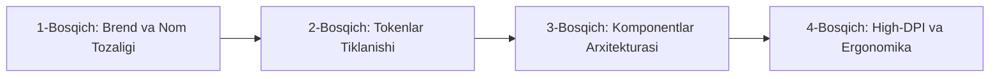

# MISA V9 — VISUAL DESIGN AUDIT: STRATEGIC DESIGN RECOMMENDATIONS
**Loyiha:** Misa Desktop AI Assistant (v9.0.0 / v9.3)  
**Audit Davri:** 2026-10-24  
**Auditor:** Principal Product Designer & Design Systems Architect  
**Katalog:** `hal qilinishi kerak bo'lgan xatoliklar\design_deep_audit_2026-10-24_18-23\`  
**Holat:** Yakunlandi (Amaliy Yo‘l Xaritasi va Tavsiyalar)

---

## 1. STRATEGIK DIZAYN TRANSFORMATSIYASI YO‘L XARITASI

Misa'ning vizual dizayni hozirgi "xom va chala yig‘ilgan shisha" holatidan jahon darajasidagi **Premium Fluent Ultra Glass** desktop mahsuloti darajasiga ko‘tarilishi uchun quyidagi 4 bosqichli amaliy yo‘l xaritasi tavsiya etiladi.



---

## 2. BOSQICHMA-BOSQICH TAVSIYALAR

### 1-Bosqich: Brend va Nom Tozaligi (Brand Integrity)
1. **`mikasa` nomini butunlay yo‘qotish:**  
   - `MisaLogo.tsx` dagi `className="... mikasa-logo"` ni tozalash.
   - `Button.tsx` dagi `className="mikasa-button ..."` ni `misa-button` ga o‘zgartirish.
   - `MikasaLogo.tsx` faylini butunlay o‘chirib, importlarni faqat `MisaLogo` ga yo‘naltirish.
2. **SVG Vektor Logotip:**  
   - Rastrli `/logo.png` o‘rniga toza vektorli SVG belgini joylashtirish. Bu Retina va 4K monitorlarda piksellashishning oldini oladi.

---

### 2-Bosqich: Dizayn Tokenlarini Tiklash (Token Healing)
1. **"Arvoh Tokenlar"ni Bartaraf Etish:**  
   `Button.tsx` va `IconButton.tsx` da chaqirilayotgan, ammo `tokens.css` da mavjud bo‘lmagan barcha o‘zgaruvchilarni to‘g‘ri tokenlarga ulash:
   - `var(--glass-bg)` o‘rniga `var(--surface)`
   - `var(--glass-border)` o‘rniga `var(--border-violet)`
   - `var(--font-size-caption)` o‘rniga `var(--text-caption)`
   - `var(--font-size-body)` o‘rniga `var(--text-body)`
2. **Yorug‘ Rejim Kontrastini To‘g‘rilash:**  
   - Komponentlardagi qattiq `color: "#FFFFFF"` larni `color: "var(--text-primary)"` ga almashtirish.
   - Yorug‘ rejimda (`html.theme-light`) matn rangi to‘q binafsha-qora `#160C24` bo‘lib ochilishini va 4.5:1 kontrast ta’minlanishini kafolatlash.
3. **Dinamik Ranglarni Aperturaga Bog‘lash:**  
   - `MisaAperture.tsx` dagi qattiq binafsha `rgba(...)` lar o‘rniga CSS dagi `--misa-accent` va `--misa-accent-glow` o‘zgaruvchilarini kiritish. Foydalanuvchi Zumrad Yashilni tanlaganda, Apertura ham yashil rejimga o‘tsin.

---

### 3-Bosqich: Komponentlar Arxitekturasi (CSS Specificity)
1. **Inline JS Hoverdan CSS Pseudo-Classga O‘tish:**  
   - `Button.tsx` va `IconButton.tsx` dagi `onMouseEnter` va `onMouseLeave` hodisalarini olib tashlash.
   - `globals.css` da toza CSS bilan yozish:
     ```css
     .btn-primary:hover {
       background-color: var(--primary-hover);
       box-shadow: var(--shadow-glow);
     }
     .btn-glass:hover {
       background-color: var(--surface-hover);
       border-color: var(--border-focus);
     }
     ```
2. **Binafsha Tugma Soya Rangi:**  
   - `Button.tsx` L64 dagi eskirgan moviy soya `rgba(2, 132, 199, 0.3)` ni olib tashlab, uning o‘rniga binafsha porlash `var(--shadow-glow)` ni o‘rnatish.

---

### 4-Bosqich: High-DPI va Displey Ergonomikasi (Ergonomics)
1. **Oyna Boshlang‘ich Balandligi:**  
   - `Misa/src-tauri/src/lib.rs` (L1435) dagi `inner_size(1200.0, 800.0)` ni `inner_size(1120.0, 700.0)` ga o‘zgartirish.
   - Bu 1080p displeyli va 150% masshtabli noutbuklarda (ishchi balandligi 720px) chat inputi pastga qirqilib ketishining oldini oladi.
2. **Blur Me’yori:**  
   - `tokens.css` dagi `--misa-blur: 24px` ni `14px` ga tushirish. Bu GPU yukini kamaytiradi va matn o‘qilishini keskin yaxshilaydi.
3. **Z-Index Tizimi:**  
   - `tokens.css` ga rasmiy z-index shkalasini kiritish:
     ```css
     --z-canvas: 0;
     --z-sidebar: 100;
     --z-topbar: 200;
     --z-dropdown: 1000;
     --z-palette: 1200;
     --z-modal: 1500;
     --z-toast: 2000;
     ```

---

## 3. TOKENLAR MIGRATSIYA JADVALI (MAPPING MATRIX)

| Eski / Buzilgan Qiymat | Fayl Manzili | Yangi Tavsiya Etilayotgan Qiymat | Kutilayotgan Vizual Foyda |
|---|---|---|---|
| `var(--glass-bg)` | `Button.tsx`, `IconButton.tsx` | `var(--surface)` | Tugma shaffof bo‘lib yo‘qolmaydi, chiroyli shisha foni paydo bo‘ladi |
| `var(--glass-border)` | `Button.tsx`, `IconButton.tsx` | `var(--border-violet)` | Yupqa binafsha aks ettiruvchi hoshiya tiklanadi |
| `rgba(2, 132, 199, 0.3)` | `Button.tsx:64` | `rgba(147, 3, 197, 0.35)` | Moviy va binafsha ranglar to‘qnashuvi yo‘qoladi |
| `color: "#FFFFFF"` | `MisaLogo.tsx:76` | `color: "var(--text-primary)"` | Yorug‘ rejimda logotip matni ko‘rinadi |
| `inner_size(1200.0, 800.0)` | `Misa/src-tauri/src/lib.rs:1435` | `inner_size(1120.0, 700.0)` | 150% noutbuklarda chat inputi ekrandan pastga qirqilmaydi |
| `--misa-blur: 24px` | `tokens.css:23` | `--misa-blur: 14px` | Matn kontrasti oshadi, 60fps silliq render bo‘ladi |
| `onMouseEnter` (JS hover) | `Button.tsx`, `IconButton.tsx` | `:hover` (CSS Pseudo-class) | Tugma kadr yo‘qotmasdan, steyt buzilishisiz silliq ishlaydi |

---

## 4. XULOSA
Ushbu tavsiyalar Misa'ning amaldagi "Deep Midnight & Luminous Violet" o‘ziga xosligini to‘liq saqlab qolgan holda, uni Windows 11 Fluent Design darajasidagi mukammal premium desktop dasturiga aylantiradi.
