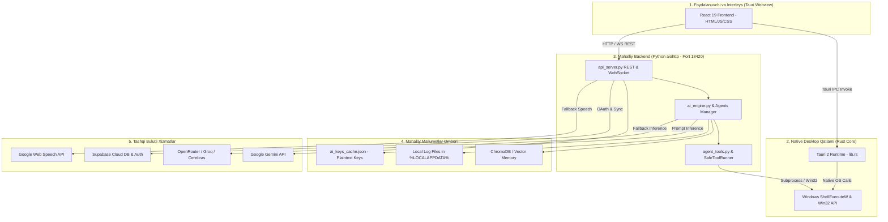

# MISA V9 — SECURITY AUDIT: STRIDE THREAT MODEL & RISK ARCHITECTURE
**Loyiha:** Misa Desktop AI Assistant (v9.0.0 / v9.3)  
**Audit Davri:** 2026-10-24  
**Auditor:** Principal Product Security Auditor & Threat Modeling Specialist  
**Katalog:** `hal qilinishi kerak bo'lgan xatoliklar\security_deep_audit_2026-10-24_18-14\`  
**Metodologiya:** Microsoft STRIDE Threat Modeling Methodology & OWASP Threat Dragon Principles  
**Holat:** Yakunlandi (Formal Threat Analysis)

---

## 1. TIZIM ARXITEKTURASI VA KOMPONENTLAR DEKOMPOZITSIYASI

Misa Desktop AI Assistant bir necha xil texnologiyalardan tashkil topgan gibrid tizimdir. Xavfsizlik tahlili uchun tizim 5 ta asosiy qatlamga ajratildi:



---

## 2. ISHONCH CHEGARALARI (TRUST BOUNDARIES)

Tizimda 4 ta muhim ishonch chegarasi (Trust Boundary) belgilandi:

- **TB-1: Webview ↔ Rust Core (Tauri IPC):**  
  Webview ichidagi JavaScript kod ishonchsiz deb hisoblanishi kerak (chunki tashqi chatdagi HTML yoki XSS uni boshqarib olishi mumkin). Rust funksiyalari (`invoke_handler`) har qanday kiruvchi parametrlarni qat’iy tekshirishi shart.
- **TB-2: Tashqi Brauzer / Mahalliy Tarmoq ↔ Python REST API (Port 18420):**  
  Localhost portida ishlayotgan serverga faqat rasmiy Misa Tauri oynasi murojaat qilishi kerak. Oddiy Chrome/Edge brauzerida ochilgan veb-sahifalar yoki boshqa dasturlar ushbu portga kirish imkoniga ega bo‘lmasligi lozim.
- **TB-3: AI Model Natijasi ↔ Operatsion Tizim (Tool Execution):**  
  Katta til modelining javobi (LLM output) hech qachon 100% ishonchli buyruq deb qaralmasligi lozim. Destruktiv amallar bajarilishidan oldin inson tasdig‘i (HITL) o‘rnatilishi shart.
- **TB-4: Mahalliy Desktop ↔ Tashqi Bulutli Servislar (Cloud APIs):**  
  Foydalanuvchining shaxsiy ma’lumotlari va API kalitlari faqat shifrlangan TLS kanallari orqali va foydalanuvchining aniq xabardorligi asosida uzatilishi lozim.

---

## 3. TAHDID AKTORLARI (THREAT ACTOR PERSONAS)

1. **TA-1: Zararli Veb-sayt Egasi (Drive-by Attacker):**  
   Foydalanuvchini o‘z saytiga jalb qilib, brauzer orqali `http://127.0.0.1:18420/api/commands/execute` manziliga yashirin so‘rovlar yuboruvchi tajovuzkor.
2. **TA-2: Bilvosita Inyeksiya Muallifi (Indirect Prompt Injection Attacker):**  
   Veb-sahifa sarlavhasiga yoki hujjat ichiga zararli promptlarni joylab, Misa'ning tizim kontekstini o‘qishi paytida agentni o‘z izmiga bo‘ysundiruvchi tajovuzkor.
3. **TA-3: Mahalliy Zararli Dastur (Low-Privilege Infostealer):**  
   Foydalanuvchi kompyuterida oddiy foydalanuvchi huquqi bilan ishlovchi va `data/ai_keys_cache.json` faylidan API kalitlarni o‘g‘irlovchi dastur.
4. **TA-4: Tarmoq Tinglovchisi (Network Eavesdropper):**  
   Mahalliy tarmoqda ochiq portlarni skanerlovchi yoki shifrlanmagan ulanishlarni tutib oluvchi shaxs.

---

## 4. STRIDE TAHLIL MATRITSASI

| STRIDE Toifasi | Aniqlangan Tahdid | Ta’sirlangan Aktiv | Mavjud Himoya | Qoldiq Xavf Darajasi | Asosiy Topilma ID |
|---|---|---|---|---|---|
| **S**poofing (Soxtalashtirish) | Telegram ID ni frontendda qo‘lda yozib begona foydalanuvchi sessiyasini yasash | Foydalanuvchi akkaunti va xotirasi | Faqat `localStorage` | **High** | `SEC-005` |
| **T**ampering (O‘zgartirish) | Port 18420 dagi ochiq REST API orqali tizim modellarini va sozlamalarini o‘zgartirish | Tizim konfiguratsiyasi | Yo‘q (Desktop rejimda auth o‘chirilgan) | **Critical** | `SEC-001` |
| **R**epudiation (Inkor etish) | Agent tomonidan o‘chirilgan fayllar yoki jarayonlar bo‘yicha imzolangan audit yo‘qligi | OS Yaxlitligi | Oddiy matnli log | **Medium** | `AISEC-002` |
| **I**nformation Disclosure (Axborot sizishi) | API kalitlarining plaintext JSON da qolishi, ovozning Google ga uzatilishi | Shaxsiy kalitlar va audio suhbatlar | Yo‘q (Plaintext JSON) | **High** | `SEC-004`, `PRIV-001` |
| **D**enial of Service (Xizmatdan to‘xtatish) | Port 18420 ga ko‘p so‘rov yuborib serverni qotirish, 404 modellar bilan loop yaratish | Ilova barqarorligi | Rate limiting mavjud emas | **Medium** | `AISEC-005` |
| **E**levation of Privilege (Huquqlarni oshirish) | `ShellExecuteW` orqali ixtiyoriy dasturni ochish, `open_app` da PowerShell inyeksiyasi | Windows Operatsion Tizimi | Yo‘q (Protokol va belgilar tekshirilmaydi) | **Critical** | `SEC-002`, `SEC-003` |

---

## 5. XAVF MATRITSASI VA PRIORITETLAR XARITASI (RISK HEATMAP)

```
        ▲ YUQORI
        │  [SEC-001: Local API Auth Bypass]    [SEC-002: ShellExecuteW RCE]
        │  [AISEC-001: Prompt Injection]       [AISEC-002: Excessive Agency]
TA'SIR  │
(Impact)│  [SEC-003: PowerShell Injection]    [SEC-004: Plaintext API Keys]
        │  [PRIV-001: Google Audio Flow]       [SEC-005: Telegram Spoofing]
        │
        │  [PRIV-002: Window Title Logs]       [AISEC-005: Model 404 Cascade]
        ▼ PAST ────────────────────────────────────────────────────────►
          KAM                                                    YUQORI
                              EHTIMOLLIK (Likelihood)
```

---

## 6. XULOSA VA QOLDIQ XAVFLARNI KAMAYTIRISH YO‘L XARITASI

Ushbu tahdid modeliga ko‘ra, Misa arxitekturasidagi eng katta xavf — **Tashqi muhitdan mahalliy operatsion tizimga o‘tish yo‘llarining (Attack Surfaces) ochiqligi**dir.

Zudlik bilan hal etilishi lozim bo‘lgan 3 ta to‘siq:
1. **TB-2 Chegarasi:** Port 18420 ga qat’iy dinamik autentifikatsiya tokeni o‘rnatish.
2. **TB-1 Chegarasi:** Rust qatlamida `ShellExecuteW` faqat `http://` va `https://` protokollariga ruxsat berishini ta’minlash.
3. **TB-3 Chegarasi:** Tizim buyruqlarida PowerShell satr formatlashidan voz kechish va qat’iy HITL tasdiqlash dialogini kiritish.
