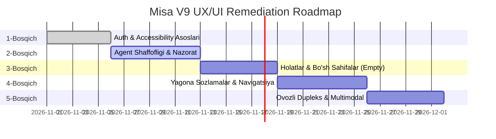

# 07 — UX/UI IMPROVEMENT ROADMAP
## MISA V9 — Bosqichma-bosqich Takomillashtirish va Foydalanish Qulayligi Rejasi

- **Hujjat turi:** Product Usability & Engineering Remediation Roadmap
- **Sana:** 2026-10-24
- **Ekspert guruhi:** Principal UX Researcher, Interaction Designer, Lead Frontend Engineer
- **Mo'ljallangan versiyalar:** Misa v9.1 – v9.5
- **Cheklov:** Kodga o'zgartirish kiritilmagan. Ushbu reja audit topilmalari asosida kelajakdagi tuzatishlar uchun yo'l xaritasidir.

---

## 1. STRATEGIK MAQSAD VA PRINSIPLAR

Misa loyihasining hozirgi holatida backend xizmatlari (12 ta maxsus agent, asinxron executor, xotira tizimi) ancha keng qamrovli, biroq frontend UI/UX darajasida quyidagi 3 ta asosiy to'siq mavjud:

1. **"Qora quti" sindromi:** Agent nima qilayotganini va qaysi toolni ishlatayotganini foydalanuvchiga ko'rsatmaslik ishonchsizlik uyg'otadi.
2. **Klaviatura va A11y to'siqlari:** Global `outline: none` va semantika yo'qligi sababli maxsus ehtiyojli va klaviatura foydalanuvchilari ilovadan to'liq foydalana olmaydi.
3. **Avtorizatsiya devori (Auth Wall) va boshlang'ich bo'shliq:** Yangi foydalanuvchi birinchi marta kirganda hech qanday tayyor taklif (prompt chip) va lokal rejim imkoniyatisiz bloklanadi.

Ushbu yo'l xaritasi muammolarni xavflilik va foydalanuvchiga ta'sir qilish darajasi bo'yicha 5 ta ketma-ket bosqichga ajratadi.

---

## 2. BOSQICHLAR TAQSIMOTI VA MATRIX

---

## 3. BOSQICHMA-BOSQICH DETALIZATSIYA

### 1-BOSQICH: KIRISH TO'SIQLARI VA ACCESSIBILITY BAZASI (Days 1–5)
**Maqsad:** Foydalanuvchining ilovaga kirishi va boshlang'ich boshqaruvni ta'minlash.

- **Vazifa 1.1: Global fokus halqasini tiklash (`A11Y-UX-002`)**
  - `App.css` dagi `input, button { outline: none; }` qoidasini to'g'irlash.
  - `:focus-visible` uchun aniq 2px binafsha/ko'k kontrastli fokus halqasi joriy etish.
  - **Acceptance Criteria:** Tab bosilganda har bir interaktiv element aniq vizual ko'rinadi.
- **Vazifa 1.2: Forma maydonlariga to'liq semantik bog'liqlik kiritish (`A11Y-UX-001`)**
  - `AuthPage.tsx` dagi barcha inputlarga `id` berish va `<label htmlFor="...">` teglari bilan bog'lash.
  - Parol ko'rsatish/yashirish tugmasiga `aria-label` va `aria-pressed` qo'shish.
  - **Acceptance Criteria:** NVDA yoki Windows Narrator barcha inputlarni turi va nomi bilan o'qiydi.
- **Vazifa 1.3: Forma yuborilishini bloklash va takroriy so'rovlarni oldini olish (`UI-STATE-003`)**
  - `isSubmitting` flag orqali tugmani `disabled` qilish va spinner ko'rsatish.
  - Enter tugmasi bosilganda bir martalik qat'iy yuborilishni ta'minlash.
  - **Acceptance Criteria:** Qayta-qayta Enter yoki Click bosilganda faqat 1 ta tarmoq so'rovi chiqadi.
- **Vazifa 1.4: "Mehmon / Lokal rejim" (Guest Mode) variantini qo'shish (`UX-HEUR-001`)**
  - Supabase serveri bilan aloqa bo'lmaganda lokal fayllar va buyruqlar bilan ishlash imkonini beruvchi tugma.

---

### 2-BOSQICH: AGENT SHAFFOFLIGI VA FOYDALANUVCHI NAZORATI (Days 6–12)
**Maqsad:** AI agent harakatlarini foydalanuvchiga to'liq ochib berish va nazoratni foydalanuvchiga qaytarish.

- **Vazifa 2.1: Reja va Qadamlar Akordeoni (Execution Plan Widget) (`AI-UX-001`)**
  - `ChatPage.tsx` da agent topshiriq olganda uning qadamlarini (Checklist) ochiluvchi blok sifatida ko'rsatish.
  - Bajarilayotgan qadam yashil belgi va qisqa izoh bilan yangilanib borishi kerak.
  - **Acceptance Criteria:** Foydalanuvchi "Misa hozir faylni qidiryaptimi yoki kod yozyaptimi?" degan savolga doimo aniq javob ko'rib turadi.
- **Vazifa 2.2: Qat'iy to'xtatish (Abort Button) mexanizmi (`UX-HEUR-002`)**
  - Chat panelida so'rov generatsiya bo'layotganda `[■ To'xtatish]` tugmasini chiqarish.
  - Frontend `AbortController` orqali SSE oqimini uzish va backend `/api/agent/cancel` endpointiga so'rov yuborish.
  - **Acceptance Criteria:** Foydalanuvchi tugmani bosishi bilan tokenlar oqimi darhol to'xtaydi va UI normal holatga qaytadi.
- **Vazifa 2.3: Xavfli amallar uchun Human-In-The-Loop (HITL) Modal Dialogi (`AI-UX-002`)**
  - `CONFIRMATION_REQUIRED` signali kelganda chiroyli glass modal chiqarish: nima o'chirilayotgani, qaysi fayl o'zgartirilayotgani va uning oqibati ko'rsatilishi kerak.
  - `[Ruxsat berish]` va `[Rad etish]` tugmalari aniq klaviatura yordamida boshqarilishi shart.
  - **Acceptance Criteria:** Foydalanuvchi tasdiqlamasa, agent hech qanday faylni o'chirmaydi.

---

### 3-BOSQICH: BO'SH HOLATLAR VA FOYDALANUVCHI YO'L-YO'RIQLARI (Days 13–18)
**Maqsad:** Yangi va bo'sh sahifalarda foydalanuvchiga aniq tushuntirish va harakatga chaqiruv (Call-To-Action) berish.

- **Vazifa 3.1: Bo'sh Xotira va Rejalashtiruvchi uchun Boy Kartalar (`UI-STATE-001`)**
  - `MemoryPage.tsx`: "Hozircha xotira bo'sh. Misa sizning qiziqishlaringiz va qoidalaringizni suhbat davomida avtomatik eslab qoladi. Istasangiz, hozir biron qoida kiriting: [Qoida qo'shish]".
  - `SchedulerPage.tsx`: "Hech qanday reja topilmadi. Agent orqali kundalik vazifalarni rejalashtirishingiz mumkin: [Birinchi rejani tuzish]".
  - **Acceptance Criteria:** Bo'sh qora ekran o'rniga foydalanuvchi keyingi qadamni tushunib turadi.
- **Vazifa 3.2: Boshlang'ich taklif chiplari (Starter Prompt Chips) (`UX-HEUR-003`)**
  - Yangi chat ochilganda ekranda 4 ta namuna taklif:
    - 🔍 "Mening ish stolidagi oxirgi loyihalarni tahlil qil"
    - 📊 "Bugungi vazifalarim va rejalarimni tuzib ber"
    - 💡 "Python loyiham uchun arxitektura taklif qil"
    - ⚡ "Tizim holati va diagnostikasini tekshir"
  - **Acceptance Criteria:** Foydalanuvchi chipni bir marta bosish bilan suhbatni boshlay oladi.
- **Vazifa 3.3: Dialog va Modal Semantikasi hamda Focus Trap (`A11Y-UX-003`)**
  - Barcha modallarga `role="dialog"`, `aria-modal="true"`, `aria-labelledby` qo'shish va fokusni modal ichida ushlab turish.

---

### 4-BOSQICH: SOZLAMALAR MARKAZI VA NAVIGATSIYA UNIFIKATSIYASI (Days 19–25)
**Maqsad:** Tarqoq holatdagi sozlamalarni bitta mantiqiy markazga birlashtirish.

- **Vazifa 4.1: Yagona `/settings` Sozlamalar Paneli**
  - `AccountPage` (profil), `VoicePage` (audio/mikrofon), `CommandsPage` (maxsus buyruqlar), `RemoteControlPage` (masofaviy boshqaruv) va AI Provayder sozlamalarini bitta yaxlit `/settings` sahifasiga vertikal tablar orqali birlashtirish:
    - ⚙️ Umumiy & Tizim
    - 🤖 AI Provayder va Modellar
    - 🎙️ Ovoz va Audio
    - 🧠 Xotira va Maxfiylik
    - 📱 Masofaviy Boshqaruv & Telegram
    - 👤 Foydalanuvchi Profili
  - **Acceptance Criteria:** Foydalanuvchi mikrofonni sozlash uchun alohida, profil uchun alohida sahifa axtarib yurmaydi.
- **Vazifa 4.2: Command Palette WAI-ARIA Combobox (`A11Y-UX-005`)**
  - Ctrl+K menyusiga to'liq WAI-ARIA Combobox semantikasi, Up/Down klaviatura bilan o'qilishi va live status berish.

---

### 5-BOSQICH: MULTIMODAL VA OVOZLI DUPLEKS MUVOZANATI (Days 26–32)
**Maqsad:** Ovozli muloqot va audio interfeysni professional darajaga olib chiqish.

- **Vazifa 5.1: Audio Ducking va Echo Suppression (`audio_service.py`)**
  - Misa TTS orqali ovoz chiqarib gapirayotgan paytda foydalanuvchi gap boshlasa (barge-in), TTS darhol so'nishi (ducking) kerak.
  - Mikrofon o'z dinamigidan chiqayotgan tovushni qayta STT ga yuborishining oldi olinishi shart.
  - **Acceptance Criteria:** Foydalanuvchi istalgan vaqtda Misa so'zini bo'la oladi, Misa o'z gapini o'zi eshitib takrorlamaydi.
- **Vazifa 5.2: Jonli vizual subtitr va tovush to'lqini (Live Captioning & Waveform) (`A11Y-UX-007`)**
  - Ovoz yozish paytida real vaqtli detsibell to'lqini va olinayotgan matn qoralamasi ekranda paydo bo'lishi lozim.
- **Vazifa 5.3: AI Provayder nosozliklarida shaffof vizual ogohlantirish (`AI-UX-004`)**
  - Model token limiti tugaganda yoki server 503 berganda qizil xabarnoma bilan birga zaxira modelga o'tish tugmasi taqdim etiladi.

---

## 4. METRIKA VA KUTILAYOTGAN NATIJALAR (KPI)

| Metrika | Hozirgi holat (Audit) | 5-Bosqichdan keyingi maqsad |
|---|---|---|
| **First-Run Time-to-First-Task** | 120–180 sekund (Majburiy Auth to'sig'i) | < 15 sekund (Lokal/Guest rejim bilan) |
| **Klaviatura orqali boshqariluvchanlik (WCAG AA)** | 15% (Outline yo'q, fokus yo'qolgan) | 100% (Barcha oqimlar klaviatura bilan) |
| **Agent topshirig'idagi bekor qilish tezligi** | 0% (To'xtatish tugmasi mavjud emas) | < 200 ms (AbortController darhol to'xtatadi) |
| **Screen Reader mosligi** | 10% (Ko'p maydonlar nomsiz) | 95%+ (WAI-ARIA APG mezonlari bo'yicha) |
| **Foydalanuvchi ishonch koeffitsiyenti (Trust Index)** | Past (Noma'lum jarayon, "qora quti") | Yuqori (Reja va harakatlar to'liq ko'rinadi) |

Ushbu yo'l xaritasi Misa'ni texnik prototipdan foydalanuvchiga qulay, ishonchli va xavfsiz premium AI mahsulot darajasiga olib chiqadi.
